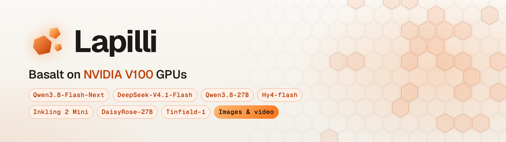
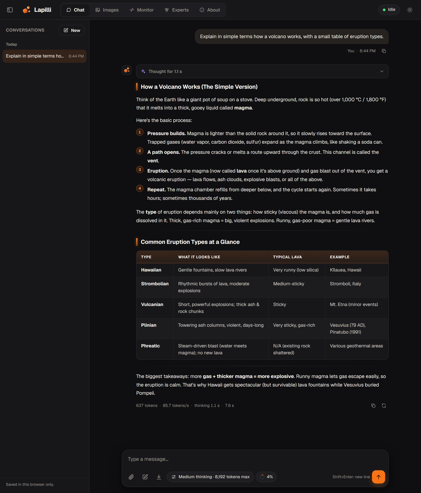
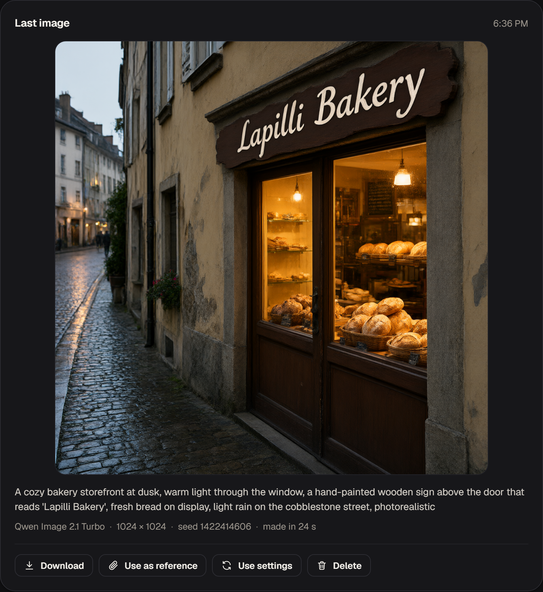
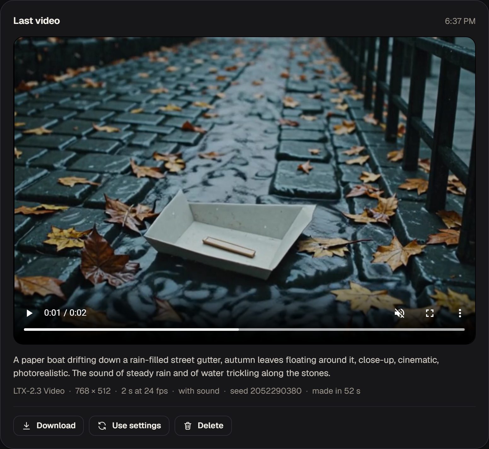
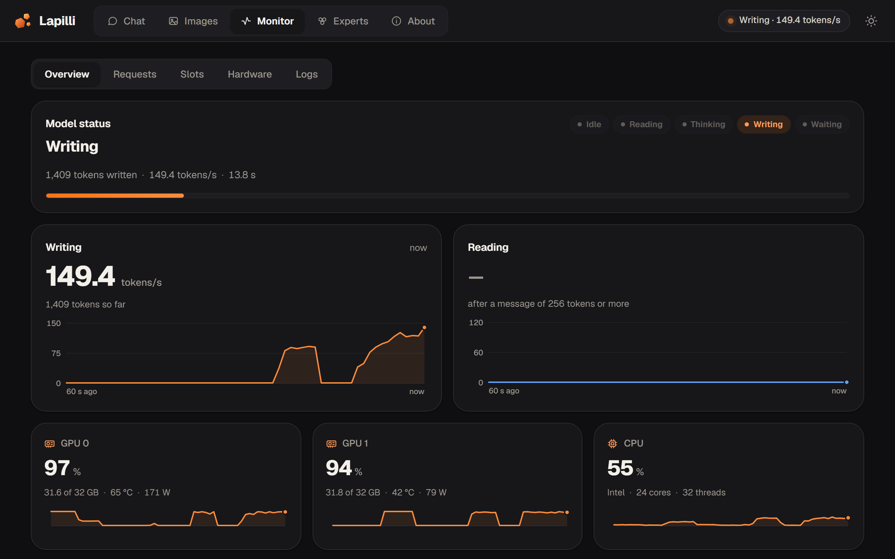
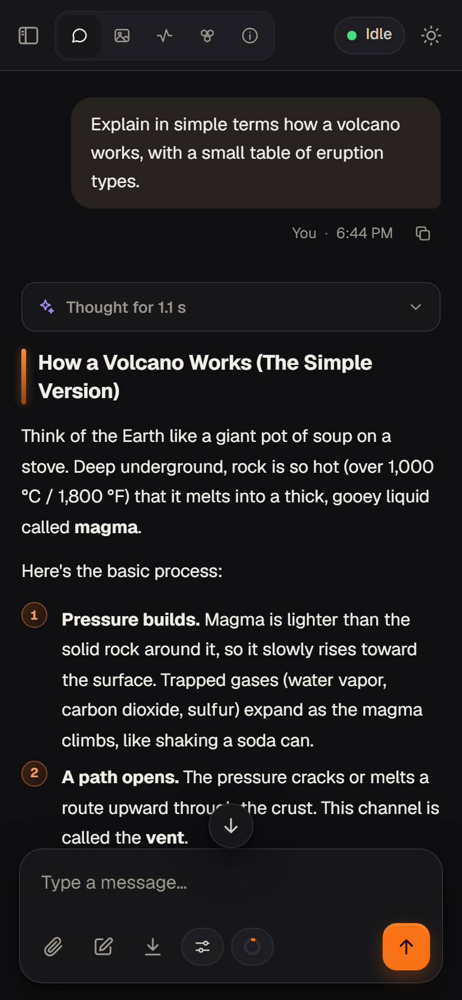
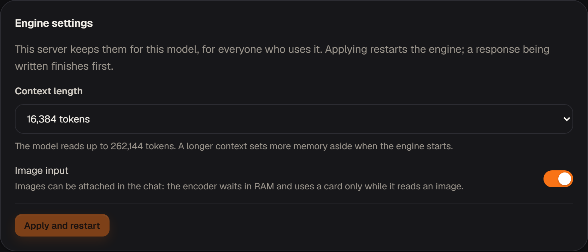
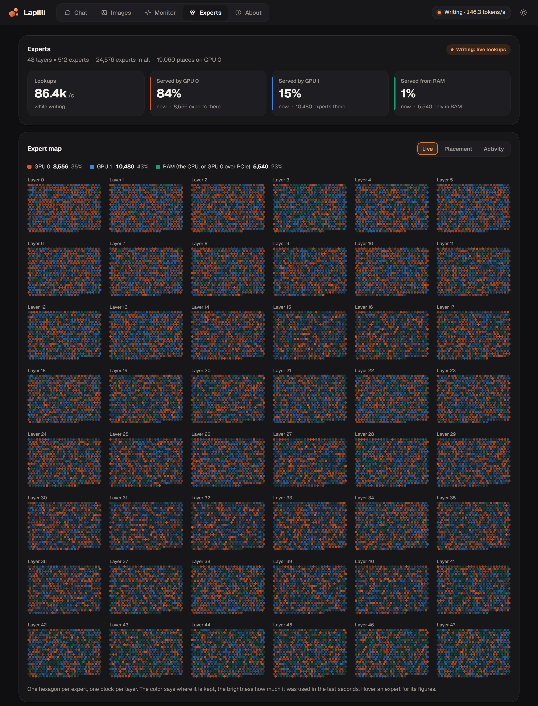

<p align="center">
  <picture>
    <source media="(prefers-color-scheme: dark)" srcset="docs/img/lapilli-banner-dark.png">
    
  </picture>
</p>

<p align="center">
  <a href="https://github.com/chris83-dev/lapilli-v100/releases"></a>
  
  
  
  <a href="LICENSE"></a>
</p>

<p align="center">
  <b>Votre V100 n'a pas dit son dernier mot.</b><br>
  Un portage de <a href="https://github.com/jesdga95/basalt">Basalt</a> pour Volta (compute capability 7.0), avec une page de
  discussion, des images et des vidéos, et un moniteur en direct.
</p>

<p align="center">
  <a href="#les-modèles">Modèles</a> ·
  <a href="#images-et-vidéo">Images et vidéo</a> ·
  <a href="#modèles-recommandés">Téléchargements</a> ·
  <a href="#nouveautés-de-la-v06">Nouveautés</a> ·
  <a href="#essayé-par-la-communauté">Communauté</a> ·
  <a href="#démarrage-rapide-windows">Démarrage rapide</a> ·
  <a href="#compiler">Compiler</a> ·
  <a href="README.md">English</a>
</p>

Basalt ne vise que Blackwell (sm_120). Lapilli ajoute sm_70 et garde la compilation Blackwell telle quelle. Un seul
`basalt.exe` fait tourner les cinq familles de modèles de Basalt sur des cartes V100, et leurs versions réentraînées passées
par le convertisseur de Basalt ; le serveur garde les API OpenAI et Anthropic de Basalt et sert la page de Lapilli à `/` (le
tableau de bord de Basalt passe à `/dashboard`). L'onglet **Images** de la page dessine, retouche et filme, avec le son, par
le `sd-server` de [stable-diffusion.cpp](https://github.com/leejet/stable-diffusion.cpp), sur les mêmes cartes.

*Les lapilli sont les petits fragments que projette un volcan : de petits morceaux de basalte.*

<p align="center"></p>
<p align="center">&nbsp;&nbsp;</p>
<p align="center">&nbsp;&nbsp;</p>
<p align="center"></p>
<p align="center"></p>
<p align="center"><sub>La page de discussion et la même page sur un téléphone, avec le Qwen3.8-Flash-Next sur deux V100 ; une image faite par
Qwen Image 2.1 Turbo et une vidéo avec son son faite par LTX-2.3, dans l'onglet Images ; le Moniteur et l'onglet Experts, les
24 576 experts du Flash-Next, pendant l'écriture d'un code ; la carte Engine settings. Captures de cette version. La page est
en anglais.</sub></p>

> Fondé sur Basalt 0.5.6 et les 29 commits qui le suivent (`main` à `bec30528`, 23 novembre 2026). Fourni tel quel, sans
> assistance (voir [Assistance](#assistance)).

## Les modèles

| | Cartes | Paquet | Vitesse d'écriture | Lecture du message | Justesse contre le BF16 |
|---|---|---|---|---|---|
| **Qwen3.8-27B**<br><sub>dense, NVFP4</sub> | **1 × V100** | 21 Go, le paquet officiel | **86** jetons/s avec son brouillon sur une conversation, 187 sur une sortie structurée | 994 jetons/s à 16K, 894 à 32K | KLD 0,02297, même 1er choix 93,37 % |
| **Inkling 2 Mini**<br><sub>mélange d'experts, 26B</sub> | **1 × V100** | 19,7 Go, le paquet officiel `DQ8` | **121** jetons/s avec son brouillon sur une conversation, 214 sur une sortie structurée | 1 567 jetons/s à 16K, 1 459 à 32K | KLD 0,00295, même 1er choix 97,77 % |
| **DaisyRose-27B**<br><sub>le 27B réentraîné</sub> | **1 × V100** | 23,7 Go, converti (voir plus bas) | **85** jetons/s avec son brouillon sur une conversation, 174 sur une sortie structurée | 835 jetons/s à 16K, 757 à 32K | KLD 0,02467, même 1er choix 92,17 % |
| **DeepSeek-V4.1-Flash Coder**<br><sub>192 experts, IQ2_XXS</sub> | 2 × V100 | 192 Go, converti (voir plus bas) | **98** jetons/s sur du code, 63 sur du texte, avec son brouillon DSpark | | pas de référence BF16 pour ce paquet ([voir plus bas](#le-détail-des-mesures)) |
| **Qwen3.8-Flash-Next**<br><sub>mélange d'experts</sub> | 2 × V100 | 115 Go, `UD-Q4_K_XL` | **137** jetons/s sur une longue réponse avec réflexion, 92 sur une courte | 1 173 jetons/s à 4K, 1 448 à 16K | KLD 0,04900, même 1er choix 92,67 % |
| **Tinfield-1**<br><sub>le Flash-Next réentraîné</sub> | 2 × V100 | 115 Go, converti (voir plus bas) | **135** jetons/s sur une longue réponse avec réflexion, 91 sur une courte | 1 177 jetons/s à 4K, 1 447 à 16K | contre le BF16 du Flash-Next : KLD 0,04850, même 1er choix 92,62 % |
| **Hy4-flash**<br><sub>220B, dont 12B actifs</sub> | 2 × V100 | 159 Go, le paquet officiel | **72** jetons/s sur une longue réponse avec réflexion, 82 sur du code | 748 jetons/s à 16K | KLD 0,20614, même 1er choix 86,26 % |

Mesuré sur une seule machine : 2 × V100-SXM2 32 Go (sur des liens PCIe 3.0 x16 et x4, pair à pair coupé : voir plus bas),
Intel Core i9-14900K, 96 Go de mémoire, Windows 10, CUDA 12.6, pilote NVIDIA 561.17, les paquets sur un SSD NVMe. Mesuré le
27 novembre 2026, avec la version de ce dépôt. Les vitesses mesurées par le serveur sont la médiane de trois passages ; celles
de `basalt-bench` sont sa moyenne de trois passages. La justesse est la porte de Basalt (`basalt-bench --quality 100` : 100
morceaux par le chemin de décodage, contre la référence BF16). Tinfield-1 n'a pas de référence BF16 à lui : contre celle du
Flash-Next, son chiffre mesure son écart au Flash-Next en BF16, réentraînement compris.

## Images et vidéo

L'onglet **Images** de la page dessine une image d'après une description, retouche vos propres images, et fait des vidéos
jusqu'à cinq secondes, avec leur son pour LTX-2.3. Il fait tourner le `sd-server` de stable-diffusion.cpp sur une carte, comme
un second moteur : les cartes ne portent qu'un moteur à la fois, donc une image décharge le modèle de discussion et démarre
`sd-server`, et le message de discussion suivant l'arrête et recharge le modèle de discussion. Pendant le dessin, la page
montre un aperçu grossier et le temps restant. Une vidéo revient en MP4, faite par `ffmpeg`, prête à jouer dans la page.

| Dans la page | Ce qu'il fait | Sur une V100 | Licence du modèle |
|---|---|---|---|
| **Qwen Image 2.1 Turbo** | des images en 8 étapes, et des retouches d'après des images de référence | 11,4 s en 1024 × 1024 | [Qwen Research License](https://huggingface.co/Qwen/Qwen-Image-2.1/blob/main/LICENSE) |
| **Qwen Image 2.1** | plus lent et plus fin, avec le guidage et une description négative | 101 s en 1024 × 1024 | [Qwen Research License](https://huggingface.co/Qwen/Qwen-Image-2.1/blob/main/LICENSE) |
| **Qwen Image Edit 2511 Lightning** | retouche vos images en 8 étapes | 55 s en 1024 × 1024 | Apache 2.0 |
| **Qwen Image Edit 2511** | retouche vos images en gardant les visages, les objets et le texte tels quels | 229 s en 1024 × 1024 | Apache 2.0 |
| **Wan 2.2 Video** | une vidéo d'après une description, ou d'après une image de départ | 276 s pour 5 s en 832 × 480 | Apache 2.0 |
| **LTX-2.3 Video** | une vidéo **avec son son**, d'après une description ou une image de départ | 59 s pour 5 s en 768 × 512 | [LTX-2 Community License](https://github.com/Lightricks/LTX-2/blob/main/LICENSE-2) |

Temps du clic au fichier fini dans la page, le modèle déjà chargé (le second travail d'affilée). Le premier travail après
un message de discussion, ou après un changement de modèle, démarre `sd-server` et lit d'abord les fichiers du modèle :
12 s de plus pour la Turbo, ses fichiers sur un SSD NVMe.

**L'onglet installe ses modèles lui-même.** L'archive Windows contient `sd-server`, compilé pour sm_70, et aucun modèle
d'image : choisissez un modèle dans l'onglet, acceptez ses licences, cliquez sur **Install**. Le serveur télécharge ses
fichiers depuis Hugging Face, aux révisions mesurées ici, vérifie chacun par son SHA-256 et le met en place ; un
téléchargement coupé reprend là où il s'est arrêté. Chaque modèle a sa propre licence, comme les encodeurs de texte que
certains utilisent : lisez-les avant d'utiliser ce qu'ils produisent. Tailles, licences, l'installation à la main (Linux, vos
propres fichiers) et les options du serveur : [docs/images.md](docs/images.md) (en anglais).

## Modèles recommandés

Les paquets avec lesquels tous les chiffres ci-dessus ont été mesurés, et où les télécharger. Chaque paquet a sa propre
licence, sur sa page Hugging Face.

La longueur du contexte et la lecture des images se règlent dans la page (About, **Engine settings**) et se gardent pour chaque
fichier de modèle : sans choix, 65 536 jetons, et les images allumées quand le paquet porte un encodeur d'images. Les
commandes ci-dessous les laissent à la page ; `--max-context N` ou `--vision` sur la ligne de commande passent devant elle.

### Qwen3.8-27B, sur une seule V100

Un modèle dense de 27 milliards de paramètres : 64 couches (48 Gated DeltaNet, 16 d'attention à porte), réflexion et outils,
un contexte jusqu'à 262 144 jetons, et un brouillon par blocs DFlash 2 dans le paquet, qui écrit plusieurs jetons à la fois.

- **Paquet** : `Qwen3.8-27B-QUASAR-NVFP4.basalt`, 21,1 Go : le paquet officiel de Basalt (poids NVFP4, depuis le checkpoint de QUASAR)
- **Téléchargement** : [jesdga/Qwen3.8-27B-Basalt](https://huggingface.co/jesdga/Qwen3.8-27B-Basalt) · [lien direct](https://huggingface.co/jesdga/Qwen3.8-27B-Basalt/resolve/main/Qwen3.8-27B-QUASAR-NVFP4.basalt)
- **Il faut** : une V100 de 32 Go

```bat
hf download jesdga/Qwen3.8-27B-Basalt Qwen3.8-27B-QUASAR-NVFP4.basalt --local-dir models
bin\basalt.exe serve models\Qwen3.8-27B-QUASAR-NVFP4.basalt --gpu 0 --kv int8 --port 8080
```

### Inkling 2 Mini, sur une seule V100

Le mélange d'experts de Thinking Machines Lab : 26,2 milliards de paramètres, dont 3,4 milliards actifs (128 experts, 8
choisis pour chaque jeton), ses 12 couches du milieu jouées trois fois pour chaque jeton, la lecture d'images, un contexte
jusqu'à 1 048 576 jetons, et un brouillon DSpark dans le paquet. Le brouillon de Basalt pour ce modèle est écrit pour
Blackwell ; Lapilli lui donne un chemin V100, allumé par défaut, avec le même texte que sans lui.

- **Paquet** : `Inkling-2-Mini-NVFP4-DQ8.basalt`, 19,7 Go, le paquet officiel à la révision `3d27b47c` : les experts routés de
  ses quatre dernières couches, en MXFP8 dans la version publiée, y gardent les mêmes valeurs en Q8_0, qu'une V100 fait tourner
  sur son chemin dp4a. Le paquet plus récent `MX8` les garde en MXFP8 ; il n'est pas essayé sur V100.
- **Téléchargement** : [jesdga/Inkling-2-Mini-Basalt](https://huggingface.co/jesdga/Inkling-2-Mini-Basalt/tree/3d27b47c40f290ecfbf3ae70265bddb65c2635c1) · [lien direct](https://huggingface.co/jesdga/Inkling-2-Mini-Basalt/resolve/3d27b47c40f290ecfbf3ae70265bddb65c2635c1/Inkling-2-Mini-NVFP4-DQ8.basalt)
- **Il faut** : une V100 de 32 Go

```bat
hf download jesdga/Inkling-2-Mini-Basalt Inkling-2-Mini-NVFP4-DQ8.basalt --revision 3d27b47c40f290ecfbf3ae70265bddb65c2635c1 --local-dir models
bin\basalt.exe serve models\Inkling-2-Mini-NVFP4-DQ8.basalt --gpu 0 --kv fp16 --vram-reserve-mib 700 --port 8080
```

### DaisyRose-27B, le 27B réentraîné, sur une seule V100

[DaisyRose-27B](https://huggingface.co/RadixArk/DaisyRose-27B), de RadixArk, est le Qwen3.8-27B réentraîné par renforcement
(Apache 2.0), meilleur que sa base sur les tâches d'agent selon ses auteurs. Il a l'architecture et le tokenizer du 27B : le
convertisseur de Basalt fabrique donc son paquet depuis le checkpoint NVFP4 de RadixArk, avec le brouillon DFlash 2 du 27B, en
deux minutes environ. Une V100 n'a pas de FP8 : ses poids d'attention et de Gated DeltaNet en FP8 deviennent du Q8_0 au
chargement ; il prend donc 2,8 Gio de plus sur la carte que le 27B et lit 17 % d'octets de plus pour chaque jeton.

- **Checkpoint** : [RadixArk/DaisyRose-27B-NVFP4](https://huggingface.co/RadixArk/DaisyRose-27B-NVFP4) (révision `d7a48599`, 6 fichiers)
- **Brouillon** : [z-lab/Qwen3.8-27B-DFlash2](https://huggingface.co/z-lab/Qwen3.8-27B-DFlash2) (révision `50307d4c`)
- **Il faut** : une V100 de 32 Go

```bat
hf download RadixArk/DaisyRose-27B-NVFP4 --revision d7a485994f1cc0c756efb9f157a9842b2df703fc --local-dir checkpoints\daisyrose-nvfp4
hf download z-lab/Qwen3.8-27B-DFlash2 --revision 50307d4c4cde6860d4eee73e2547cd786fe8e8a4 --local-dir checkpoints\dflash2
.venv\Scripts\python tools\convert\convert.py --checkpoint checkpoints\daisyrose-nvfp4 --drafter checkpoints\dflash2 --name "DaisyRose-27B NVFP4" --out models\DaisyRose-27B-NVFP4.basalt
bin\basalt.exe serve models\DaisyRose-27B-NVFP4.basalt --gpu 0 --kv int8 --port 8080
```

Le paquet fini fait 23 749 973 433 octets. Basalt ne publie pas de référence BF16 pour lui : celle qui a servi à mesurer sa
justesse a été faite comme celles de Basalt, depuis le GGUF BF16 ([bartowski](https://huggingface.co/bartowski/RadixArk_DaisyRose-27B-GGUF)),
par `llama-perplexity` de llama.cpp.

### DeepSeek-V4.1-Flash Coder, sur deux V100

DeepSeek-V4.1-Flash est un mélange d'experts : 40 couches de 384 experts, 6 choisis pour chaque jeton plus un expert partagé.
Le Coder GSQ-RCO d'ISTA-DASLab est une version pour le code qui garde 192 des 384 experts de chaque couche, en IQ2_XXS ; le
brouillon DSpark d'Unsloth écrit plusieurs jetons à la fois. Il n'existe pas de paquet Basalt tout fait : on le fabrique à
partir des fichiers GGUF (environ 184 Go à télécharger, 192 Go une fois fabriqué).

- **Modèle** : [ISTA-DASLab/DeepSeek-V4.1-Flash-1017-GSQ-RCO-Coder-GGUF](https://huggingface.co/ISTA-DASLab/DeepSeek-V4.1-Flash-1017-GSQ-RCO-Coder-GGUF) (révision `54229d38`) : les cinq morceaux de `IQ2_XXS/` (72,1 Go), la table Engram `DeepSeek-V4.1-Flash-Engram-IQ4_NL.gguf` (110,6 Go) et `mmproj-DeepSeek-V4.1-Flash-1017-BF16.gguf` (1,0 Go)
- **Brouillon** : [unsloth/DeepSeek-V4.1-Flash-1017-GGUF](https://huggingface.co/unsloth/DeepSeek-V4.1-Flash-1017-GGUF) (révision `dfcee0ec`) : `dspark-DeepSeek-V4.1-Flash-1017-Q8_0.gguf` (8,0 Go)
- **Il faut** : deux V100 de 32 Go, 96 Go de mémoire dont 20 Go gardés libres (son étage en mémoire est verrouillé), un SSD NVMe rapide

1. Mettre les cinq morceaux `IQ2_XXS`, le fichier `mmproj` et la table Engram dans un même dossier, la table Engram renommée
   en sixième morceau : `DeepSeek-V4.1-Flash-1017-GSQ-RCO-Coder-IQ2_XXS-00006-of-00006.gguf`.
2. Convertir, puis ajouter le brouillon (le convertisseur lit les GGUF projetés en mémoire : une dizaine de minutes depuis un
   SSD NVMe), puis lancer le serveur :

```bat
.venv\Scripts\python tools\convert\convert.py --gguf <dossier>\DeepSeek-V4.1-Flash-1017-GSQ-RCO-Coder-IQ2_XXS-00001-of-00006.gguf --mmproj <dossier>\mmproj-DeepSeek-V4.1-Flash-1017-BF16.gguf --out models\DeepSeek-V4.1-Flash-1017-GSQ-RCO-Coder-IQ2_XXS.basalt
.venv\Scripts\python tools\convert\convert.py --dspark dspark-DeepSeek-V4.1-Flash-1017-Q8_0.gguf --into models\DeepSeek-V4.1-Flash-1017-GSQ-RCO-Coder-IQ2_XXS.basalt --undo-dir models\dspark-undo
bin\basalt.exe serve models\DeepSeek-V4.1-Flash-1017-GSQ-RCO-Coder-IQ2_XXS.basalt --gpu 0,1 --kv fp16 --vram-reserve-mib 700 --ram-reserve-mib 20480 --port 8080
```

Le paquet fini fait 192 059 655 012 octets, en 14 sections. Son classement des experts pour 192 experts, tiré de celui du
modèle de base par `tools/profiles/derive_pruned_profile.py`, est dans `data/profiles/`. Une V100 n'a pas de FP8 : le contexte
est en fp16.

### Qwen3.8-Flash-Next, sur deux V100

Un mélange d'experts : 48 couches (36 Gated DeltaNet, 12 d'attention QSA) de 512 experts, 10 choisis pour chaque jeton, un
brouillon MTP dans le paquet, et la lecture d'images. Les experts qui ne tiennent pas dans les cartes sont lus depuis la
mémoire, et sa table de jetons par couche est lue dans le paquet à chaque jeton : gardez le paquet sur un SSD NVMe.

- **Paquet** : `Qwen3.8-FN-UD-Q4_K_XL.basalt`, 115 Go (K-quants : les paquets NVFP4 de ce modèle demandent du matériel FP4)
- **Téléchargement** : [jesdga/Qwen3.8-Flash-Next-Basalt](https://huggingface.co/jesdga/Qwen3.8-Flash-Next-Basalt) · [lien direct](https://huggingface.co/jesdga/Qwen3.8-Flash-Next-Basalt/resolve/main/Qwen3.8-FN-UD-Q4_K_XL.basalt)
- **Il faut** : deux V100 de 32 Go, 96 Go de mémoire, un SSD NVMe rapide
- **Plus petit** : `Qwen3.8-FN-UD-IQ3_XXS.basalt` (87,6 Go, même page), lancé par un utilisateur sur une seule V100 de 16 Go : voir [son rapport](docs/community/v100-16gb-linux.md)

```bat
hf download jesdga/Qwen3.8-Flash-Next-Basalt Qwen3.8-FN-UD-Q4_K_XL.basalt --local-dir models
bin\basalt.exe serve models\Qwen3.8-FN-UD-Q4_K_XL.basalt --gpu 0,1 --kv int8 --mmap-experts --resident-experts --peer-exclusive --vram-reserve-mib 700 --ram-reserve-mib 16384 --port 8080
```

### Tinfield-1, le Flash-Next réentraîné, sur deux V100

[Tinfield-1](https://huggingface.co/badtheorylabs/Tinfield-1), de badtheorylabs, est le Flash-Next réentraîné pour le travail
au terminal et les longues tâches de programmation (Qwen Community License 1.0). Seuls ses poids d'attention, de Gated
DeltaNet et d'hyper-connexions ont changé : ses experts, ses routeurs, sa tête, ses plongements, son encodeur d'images et sa
couche MTP sont ceux du Flash-Next. Son paquet est donc son propre GGUF, avec le brouillon et les sections d'images du paquet
du Flash-Next, et il tourne à la vitesse du Flash-Next.

- **Modèle** : [badtheorylabs/Tinfield-1-Q4_K_XL-GGUF](https://huggingface.co/badtheorylabs/Tinfield-1-Q4_K_XL-GGUF) (révision `ea53c4c6`, six morceaux, 111 Go)
- **Paquet de base** : le paquet du Flash-Next ci-dessus (son brouillon et ses sections d'images sont recopiés dans le nouveau paquet)
- **Il faut** : deux V100 de 32 Go, 96 Go de mémoire, un SSD NVMe rapide

```bat
hf download badtheorylabs/Tinfield-1-Q4_K_XL-GGUF --revision ea53c4c66cff9efdd08c96423838d9a221cca53e --local-dir checkpoints\tinfield
.venv\Scripts\python tools\convert\convert.py --gguf checkpoints\tinfield\tinfield-1-Q4_K_XL-00001-of-00006.gguf --sections-from models\Qwen3.8-FN-UD-Q4_K_XL.basalt --compat-bf16 --name "Tinfield-1 Q4_K_XL" --out models\Tinfield-1-Q4_K_XL.basalt
bin\basalt.exe serve models\Tinfield-1-Q4_K_XL.basalt --gpu 0,1 --kv int8 --mmap-experts --resident-experts --peer-exclusive --vram-reserve-mib 700 --ram-reserve-mib 16384 --port 8080
```

`--compat-bf16` met en BF16, la forme que lit le moteur, les petites matrices que ce GGUF range en Q8_0. Le paquet fini fait
115 250 943 691 octets ; `convert.py --verify` le relit contre le GGUF : chaque tenseur est le même, octet pour octet, sauf
les 483 passés en BF16. `--dry-run` ne marche pas avec `--sections-from` : lancez la conversion elle-même.

### Hy4-flash, sur deux V100

Le mélange d'experts de Tencent : 220 milliards de paramètres, dont 12 milliards actifs, une table Engram lue dans le paquet au
fil de l'écriture, la lecture d'images, et un contexte jusqu'à 1 048 576 jetons (Tencent Hy License 1.0).

- **Paquet** : `Hy4-flash-NVFP4.basalt`, 159 Go : le paquet officiel de Basalt
- **Téléchargement** : [jesdga/Hy4-flash-Basalt](https://huggingface.co/jesdga/Hy4-flash-Basalt) · [lien direct](https://huggingface.co/jesdga/Hy4-flash-Basalt/resolve/main/Hy4-flash-NVFP4.basalt)
- **Il faut** : deux V100 de 32 Go, 96 Go de mémoire, un SSD NVMe rapide. Chaque expert doit tenir sur une carte ou en
  mémoire : avec 96 Go, gardez la réserve à 10 Go comme ci-dessous.

```bat
hf download jesdga/Hy4-flash-Basalt Hy4-flash-NVFP4.basalt --local-dir models
bin\basalt.exe serve models\Hy4-flash-NVFP4.basalt --gpu 0,1 --kv fp16 --vram-reserve-mib 700 --ram-reserve-mib 10240 --port 8080
```

Choisissez le contexte dont vous avez besoin : sans la gestion de mémoire virtuelle de CUDA (les V100 de la machine d'essai,
sous Windows, ne l'ont pas), le moteur réserve tout le contexte au départ. Là, 262 144 jetons prennent 3,6 Gio de la première
carte ; 1 048 576 en prennent 14,3, ce qui laisse moins d'experts sur la carte et ralentit l'écriture d'un tiers environ.

## Le détail des mesures

<details>
<summary><b>Qwen3.8-27B sur une seule V100</b></summary>

Une V100 n'a de cœurs tensoriels ni FP4 ni FP8. Au chargement, les plans NVFP4 du paquet deviennent sur place les blocs
NVFP4 de ggml et la tête FP8 devient du Q8_0 ; les produits passent par le chemin dp4a et, pour les longs messages, par les
cœurs tensoriels de Volta. Nouveau dans la v0.6 : dès 1 024 lignes par morceau, les produits du message décodent les poids
NVFP4 en FP16 par tranches (exactement) et passent en produits FP16 sur les cœurs tensoriels, avec un seul algorithme fixe,
pour que le résultat d'une ligne ne dépende pas de la taille du morceau (`BASALT_DENSE_HGEMM=0` l'éteint). Sur le chemin
dp4a, les activations restent en 8 bits, là où Blackwell les arrondit à 4.

| | Lapilli, 1 × V100 | Chiffres de Basalt sur une RTX 5090 (contexte int8) |
|---|---|---|
| Perplexité (BF16 : 6,7411) | 6,8304 | 6,826 |
| KLD moyenne | 0,02297 | 0,0259 |
| Même 1er choix | 93,37 % | 92,89 % |

| Écriture (`basalt-bench -t conv,struct,prose`, graine 7) | conversation | structurée | texte |
|---|---|---|---|
| Avec le brouillon DFlash 2 (par défaut) | 86 | 187 | 65 |
| Sans brouillon (`--spec 0`) | 40 | 37 | 38 |

| Lecture du message, jetons/s | 16K | 32K | 64K |
|---|---|---|---|
| v0.6 | 994 | 894 | 740 |
| v0.5, même machine | 693 | 633 | 554 |

Écriture après un long message, sans brouillon : 33,3 jetons/s après 32K, 29,9 après 64K
(`basalt-bench --depth-decode`).

</details>

<details>
<summary><b>Inkling 2 Mini sur une seule V100</b></summary>

| | Lapilli, 1 × V100 | Chiffres de Basalt sur une RTX 5090 |
|---|---|---|
| Perplexité (BF16 : 7,0633) | 7,0731 | 7,0695 |
| KLD moyenne | 0,00295 | 0,00305 |
| Même 1er choix | 97,77 % | 97,76 % |

| Écriture (`basalt-bench -t conv,struct,prose`, graine 7) | conversation | structurée | texte |
|---|---|---|---|
| Avec le brouillon DSpark (par défaut) | 121 | 214 | 103 |
| Sans brouillon (`--spec 0`) | 95 | 92 | 95 |

Lecture du message : 1 567 jetons/s à 16K jetons, 1 459 à 32K, son attention de lecture sur les cœurs tensoriels de
Volta (WMMA). Sur V100, la lecture à l'avance des experts dans le cache L2, faite pour le grand L2 de Blackwell, est coupée.

</details>

<details>
<summary><b>DaisyRose-27B sur une seule V100</b></summary>

| | DaisyRose-27B | Qwen3.8-27B, mêmes passages |
|---|---|---|
| Perplexité (son propre BF16 : 6,7646) | 6,8360 | 6,8304 |
| KLD moyenne | 0,02467 | 0,02297 |
| Même 1er choix | 92,17 % | 93,37 % |
| Écriture avec le brouillon, conversation / structurée / texte | 85 / 174 / 59 | 86 / 187 / 65 |
| Lecture du message à 16K / 32K | 835 / 757 | 994 / 894 |

</details>

<details>
<summary><b>DeepSeek-V4.1-Flash Coder sur deux V100</b></summary>

Écriture gloutonne, par le serveur (la médiane de trois passages après une chauffe) : 98 jetons/s sur du code (une
classe Python complète, 512 jetons), 63 sur du texte (256 jetons), avec le brouillon DSpark.

Il n'existe pas de référence BF16 pour ce paquet. Contre celle du DeepSeek-V4.1-Flash complet (384 experts,
`dsv41-bf16-base.kld` de Basalt, perplexité de base 2,7314), il obtient une perplexité de 5,4196, une KLD de 0,85367
et le même 1er choix dans 70,27 % des cas sur les 100 morceaux de wikitext-2 ; la v0.5, le même soir : 0,85386 et
70,30 %. Ces chiffres mesurent ce que coûtent ensemble la moitié des experts retirés et l'IQ2_XXS sur un texte en prose,
pas l'erreur propre du paquet : il est fait pour le code.

Ce modèle garde une disposition plus rapide de ses produits Q5_K, propre à la V100, allumée par défaut pour lui seul : avec
elle, les bits d'une ligne dépendent de la largeur de sa fenêtre, mais son texte dépend déjà de l'endroit où vivent ses
experts (sur une carte ou en mémoire), d'un passage à l'autre. `BASALT_MULTI_V70=0` l'éteint.

</details>

<details>
<summary><b>Qwen3.8-Flash-Next et Tinfield-1 sur deux V100</b></summary>

| | Flash-Next | Tinfield-1 | Chiffres publiés par Basalt pour le paquet du Flash-Next (RTX 5090) |
|---|---|---|---|
| Perplexité (BF16 du Flash-Next : 3,2733) | 3,3245 | 3,2172 | 3,321 |
| KLD moyenne, contre le BF16 du Flash-Next | 0,04900 | 0,04850 | 0,0496 |
| Même 1er choix | 92,67 % | 92,62 % | 92,63 % |

| | Flash-Next, v0.6 | Flash-Next, v0.5 (même machine et mêmes passages) | Tinfield-1 |
|---|---|---|---|
| Écriture, réponse courte (256 jetons, température 0) | 92 jetons/s | 91 jetons/s | 91 jetons/s |
| Écriture, longue réponse avec réflexion (1 500 jetons) | 137 jetons/s | 140 jetons/s | 135 jetons/s |
| Lecture du message, ~4 200 / ~16 000 jetons | 1 173 / 1 448 jetons/s | 1 169 / 1 446 jetons/s | 1 177 / 1 447 jetons/s |

</details>

<details>
<summary><b>Hy4-flash sur deux V100</b></summary>

| | Lapilli, 2 × V100 | Chiffres de Basalt (RTX 5090 et RTX 5060 Ti) |
|---|---|---|
| KLD moyenne | 0,20614 | 0,201 |
| Même 1er choix | 86,26 % | 86,09 % |

Le NVFP4 coûte plus à ce modèle qu'aux autres, sur Blackwell comme ici. Écriture : 72 jetons/s sur une longue réponse avec
réflexion (1 500 jetons), 82 sur du code (une classe Python complète, 512 jetons) ; lecture du message 624 jetons/s à 4K, 748 à 16K. Son attention de lecture (MLA) passe sur les
cœurs tensoriels de Volta (WMMA) ; les lignes d'experts de la seconde carte sont additionnées pour chaque jeton, en FP16, avant
de passer le bus.

</details>

141 des 156 essais de parité GPU de Basalt passent sur une V100. Les autres essaient des chemins que la V100 ne prend pas :
des noyaux propres à Blackwell (FP8, FP4, TMA), des groupes de blocs (le moteur prend son chemin sans groupes), plus de
96 Ko de mémoire partagée par bloc, un essai bf16 que sm_70 ne compile pas, et trois empreintes du DeepSeek relevées sur
Blackwell, dont les bits s'additionnent dans un autre ordre sur Volta (leurs contrôles numériques passent). Pour le 27B et
le Flash-Next, chaque ligne d'un produit donne les mêmes bits quelle que soit la largeur de sa fenêtre : un brouillon change
la vitesse, jamais la réponse.

## Nouveautés de la v0.6

- **Deux nouvelles familles de modèles sur Volta.** **Hy4-flash** sur deux V100 : son attention de lecture (MLA) sur les cœurs
  tensoriels, les lignes d'experts de la seconde carte additionnées en FP16 avant de passer le bus, la lecture à l'avance des
  experts dans le cache L2 coupée sur une carte au petit L2. **Inkling 2 Mini** sur une seule V100 : son brouillon DSpark sur
  V100, son attention de lecture sur les cœurs tensoriels, la même justesse que Basalt sur une RTX 5090.
- **Des modèles réentraînés, convertis en quelques minutes** par le convertisseur de Basalt : DaisyRose-27B depuis son
  checkpoint NVFP4, Tinfield-1 depuis son GGUF avec le brouillon et les images du paquet du Flash-Next.
- **Le 27B lit les longs messages plus vite** : +43 % à 16K, par des produits FP16 sur les cœurs tensoriels (une idée
  de [ninfer-v100-fast](https://github.com/ddominet/ninfer-v100-fast), Apache 2.0). Au bout de son contexte, il arrête
  maintenant d'écrire au lieu d'échouer.
- **Images et vidéo** : l'onglet Images, avec `sd-server` comme second moteur sur les mêmes cartes, et ses modèles installés
  depuis l'onglet en un clic (voir [Images et vidéo](#images-et-vidéo)).
- **Les réglages du moteur dans la page** (About) : la longueur du contexte et la lecture des images, gardées pour chaque
  fichier de modèle et appliquées en relançant le moteur.
- **Une longue conversation continue** : près du bout du contexte, la page laisse de côté la réflexion des tours passés, ou
  remplace les plus anciens tours par un résumé ; une réponse coupée par le contexte continue dans sa bulle (**Continue**),
  comme dans la page de llama.cpp. Le serveur continue une conversation qui finit par un message de l'assistant
  (`--prefill-assistant`, allumé par défaut).
- **« This page was updated »** : la page prévient quand les fichiers du serveur sont plus récents que ceux qu'elle fait tourner.
- **Basalt 0.5.6** : le fork suit de nouveau `main` (515 commits de Basalt depuis la base de la v0.5), avec tous les chemins
  Volta gardés.
- **De la communauté** : les deux correctifs de koldfrontier, un essai de vision qui compile avec CUDA 12.8 et gcc 14.3,
  et le passage à blanc du convertisseur qui ne s'arrête plus à la section `hc8`.
- **Le numéro de Lapilli** : l'onglet About et `/metrics` donnent celui de Lapilli (0.6.0) à côté de celui de Basalt (0.5.6).

Les versions précédentes, [v0.5.0-v100.1](https://github.com/chris83-dev/lapilli-v100/releases/tag/v0.5.0-v100.1) et
[v0.4.0-v100.1](https://github.com/chris83-dev/lapilli-v100/releases/tag/v0.4.0-v100.1), restent disponibles.

## Essayé par la communauté

Des utilisateurs ont essayé Lapilli sur leurs propres machines et ont tout partagé. Leurs chiffres, tels qu'ils les ont
donnés :

| | Machine | Ce qu'ils ont fait tourner | Leurs résultats |
|---|---|---|---|
| **[nebod99](docs/community/one-v100-pcie-linux.md)** | 1 × V100 PCIe 32 Go, Linux (CUDA 12.6.3 sous Docker), i9-10940X, 96 Go | v0.4, Qwen3.8-Flash-Next `IQ3_S`, un message de 7 242 jetons, réflexion allumée | **100,9 jetons/s** à 128K de contexte (Strata : 55,6), premier jeton en **8,7 s** (22,6) ; sur plus de 2 500 questions, la même justesse que Strata |
| **[ildargiv](docs/community/v100-16gb-linux.md)** | 1 × V100-SXM2 **16 Go**, Ubuntu 22.04, Ryzen 5 5600G, 96 Go | v0.4, Qwen3.8-Flash-Next `IQ3_XXS`, la première carte de 16 Go | **67,8 / 76,0 / 70,4 jetons/s** en écriture après des messages de 1K / 8K / 32K ; lecture 497 / 1 033 / 1 174 jetons/s ; un réglage stable pour 16 Go |
| **[Csavoldi](docs/community/inkling2-mini.md)** | 2 × V100 PCIe 32 Go, une en service | **Inkling 2 Mini** porté sur Lapilli : Basalt v0.5.5 fusionné avec les chemins Volta | **69 jetons/s** en écriture (60,5 à 42K, 44,4 à 165K) ; lecture 850 jetons/s ; contexte de 512K ; 5 sur 5 au premier choix contre llama.cpp |
| **[koldfrontier](docs/community/two-v100-pcie-linux.md)** | 2 × V100 32 Go, les deux en service, Ubuntu 26.04, 2 × Xeon Gold 6138, 192 Go | v0.4 et v0.5, des versions réentraînées du Qwen3.8-Flash-Next en Q5_K, deux créneaux de 262K | v0.4 : deux demandes à la fois à **69,8 jetons/s chacune** (Strata : 52,0), plus long arrêt à côté d'un message de 109K **0,19 s** (7,0) ; une seule demande 76 (Strata : 86) ; la v0.5 à la même vitesse que la v0.4 ; accès pair à pair exact à l'octet sur cette carte mère |
| **[nkhaooat](docs/community/three-engines-two-v100-pcie.md)** | 2 × V100 PCIe 32 Go (Gen3 x8, pair à pair allumé), Ryzen 9 7945HX3D, 96 Go, Linux | v0.5, Qwen3.8-Flash-Next `UD-Q4_K_XL`, contexte de 262K, deux créneaux, contre Strata et sFNX sur 966 essais notés | la même justesse que les deux autres (860 réussis ; Strata 864, sFNX 858) ; **146,2 jetons/s** sur des retouches et **117,6** sur du code (sFNX 107,7 / 101,3, Strata 59,5 / 77,1) ; lecture 1 453 jetons/s à 35,8K (sFNX 2 060) |

Merci à nebod99, ildargiv, Csavoldi, koldfrontier et nkhaooat. Lapilli n'avait jamais tourné que sur une seule machine ; vous
l'avez emmené sous Linux, sur une seule carte, sur une V100 de 16 Go, vers un nouveau modèle et sur des paires PCIe avec le
pair à pair allumé, en le mesurant avec soin contre d'autres moteurs et en écrivant ce qu'il faut pour refaire la même chose.
Chaque propriétaire de V100 profite de votre travail.

## Démarrage rapide (Windows)

1. Télécharger `lapilli-v100-v0.6.0-v100.1-windows-x64.zip` depuis les [versions](https://github.com/chris83-dev/lapilli-v100/releases)
   et le décompresser. Il contient `bin\` (`basalt`, `basalt-bench`, `basalt-probe`, `basalt-vision`, et `sd-server`,
   `sd-cli` pour l'onglet Images), le serveur, la page,
   `data\`, `docs\`, `requirements.txt` et les licences, compilés pour les cinq familles de modèles ; comme les archives de
   Basalt, ni bibliothèques CUDA ni environnement Python.
2. Installer un pilote NVIDIA qui prend en charge CUDA 12.6 (essayé : 561.17), les bibliothèques d'exécution de CUDA 12 dans le
   `PATH` (`cudart64_12.dll`, `cublas64_12.dll`, `cublasLt64_12.dll` : le CUDA Toolkit 12.6 à 12.9 les installe) et le
   Microsoft Visual C++ 2015-2022 Redistributable (x64).
3. Créer l'environnement Python à la racine de l'archive : `py -3 -m venv .venv` puis
   `.venv\Scripts\pip install -r requirements.txt`.
4. Télécharger un paquet et lancer le serveur avec sa commande (voir [Modèles recommandés](#modèles-recommandés)), puis
   ouvrir `http://127.0.0.1:8080/`. L'onglet Images est là dès le départ : installez-y un modèle.

## Prérequis

- Une ou plusieurs cartes NVIDIA V100 : une carte de 32 Go pour le 27B, DaisyRose-27B et Inkling 2 Mini ; deux pour le
  DeepSeek Coder, le Flash-Next, Tinfield-1 et Hy4-flash tels que mesurés. Essayé par des utilisateurs : des V100 PCIe 32 Go,
  seules et par paires, et une V100-SXM2 16 Go avec le Flash-Next (voir [Essayé par la communauté](#essayé-par-la-communauté)).
- Windows 10 ou 11 x64, ou Linux (lancé par des utilisateurs avec CUDA 12.6.3 sous Docker, sous Ubuntu 22.04, et sous Ubuntu
  26.04 avec CUDA 12.8 ; les étapes de compilation ci-dessous sont pour Windows).
- CUDA Toolkit 12.6 à 12.9 (CUDA 13 a abandonné Volta), Visual Studio 2022 Build Tools (C++), CMake 3.24+, Python 3.10+.
- De la mémoire vive et un SSD rapide pour les experts qui ne tiennent pas dans les cartes. Essayé avec 96 Go de mémoire.
- Pour l'onglet Images : de la place sur le disque pour ses modèles (13 à 40 Go chacun) ; l'archive Windows contient
  `sd-server`, et l'onglet installe `ffmpeg` pour les vidéos (sous Linux : compiler `sd-server` et installer `ffmpeg`, voir
  [docs/images.md](docs/images.md)).

## Compiler

Depuis une *x64 Native Tools Command Prompt for VS 2022* :

```bat
git clone https://github.com/chris83-dev/lapilli-v100 lapilli && cd lapilli
cmake -S . -B build70 -G Ninja -DCMAKE_BUILD_TYPE=Release -DCMAKE_CUDA_ARCHITECTURES=70 -DCMAKE_CUDA_RUNTIME_LIBRARY=Shared
cmake --build build70
py -3 -m venv .venv
.venv\Scripts\pip install -r requirements.txt
```

Les exécutables arrivent dans `bin\`, compilés pour les cinq familles de modèles (`-DBASALT_MODELS=` avec une liste comme
`qwen4exp;qwen35` en compile moins). Une compilation complète des cinq familles de modèles, essais compris, a pris 50 minutes sur un i9-14900K de 24 cœurs
avec 6 travaux en parallèle. `-DCMAKE_CUDA_RUNTIME_LIBRARY=Shared` évite un `cudart` en double à
l'édition des liens sous Windows. `-DBUILD_TESTING=ON` ajoute les essais de parité (`ctest --test-dir build70 -L gpu`). Sous
Linux, des utilisateurs l'ont compilé avec les mêmes options CMake (voir leurs rapports).

## Ce qui change par rapport à Basalt

- **Compilation** : la compute capability 7.0 est acceptée à côté de 12.0, avec CUDA 12.6 ou plus récent.
- **Une couche de compatibilité** (`include/basalt/kernels/volta_compat.cuh`) : les instructions PTX récentes utilisées par le
  moteur (`cp.async`, `ldmatrix`, les formes `mma` de Turing et d'Ampere, conversions tf32 et bf16) ont un équivalent juste en
  sm_70, et `griddepcontrol` et la lecture à l'avance dans le L2 ne font rien, donc les noyaux compilent et tournent juste sur
  une V100. Les noyaux qui ont besoin de groupes de blocs ont des versions V100 sans eux.
- **Des chemins V100 pour les noyaux chauds** : le chemin dp4a de llama.cpp pour les produits quantifiés des messages, et sa
  version NVFP4 sur les cœurs tensoriels de Volta avec les mêmes bits ; des produits FP16 sur les cœurs tensoriels pour les
  longs messages du 27B ; l'attention int8 de lecture sur les cœurs tensoriels de la V100 (`mma.m8n8k4`, de Strata) ;
  l'attention de lecture du 27B, d'Inkling 2 Mini et de Hy4-flash sur WMMA ; la lecture des hyper-connexions, le routeur, les
  experts du décodage et la récurrence GDN réécrits pour Volta ; le brouillon DSpark d'Inkling sur V100 ; l'indexeur du
  DeepSeek sans groupes de blocs ; l'échange d'experts entre deux cartes réglé pour la V100.
- **L'accès pair à pair est coupé par défaut sur Volta** : sur la machine d'essai, les copies directes entre les deux V100
  rendaient des données fausses. Les copies passent par l'hôte. `BASALT_PEER_NO_P2P=0` rallume l'accès pair à pair, à vos
  risques. Deux utilisateurs l'allument sur des paires PCIe, après un essai exact à l'octet réussi sur leurs cartes mères (voir
  les rapports de koldfrontier et de nkhaooat) : faites un tel essai avant de l'allumer.
- **Serveur** : la reprise exacte d'un tour suivant ; la carte des experts et les chiffres des créneaux sur `/metrics` et
  `/slots` ; `fit_max_tokens: true` dans une requête ramène son `max_tokens` à la place que laisse le contexte ; une
  conversation qui finit par un message de l'assistant le continue ; les réglages du moteur de la page
  (`/api/engine-settings`) ; images et vidéos par `sd-server` (`/api/images`, et `POST /v1/images/generations`).
- **La page de Lapilli** à `/`, avec son onglet Images ; le tableau de bord de Basalt à `/dashboard`.

Les variables d'environnement `BASALT_*` ajoutées par le portage sont les interrupteurs A/B de ses mesures ; leurs valeurs par
défaut sont les meilleures mesurées sur V100, et ce ne sont pas des réglages. Quelques-unes peuvent aider : `BASALT_MMQ_HMMA=0`
et `BASALT_ATTN_PROMPT=i8` remettent les produits et l'attention de la lecture sur leurs voies de la v0.4 si une nouvelle voie
se comporte mal sur votre carte ; `BASALT_DENSE_HGEMM=0` remet les longs messages du 27B sur la voie de la v0.5 ;
`BASALT_MULTI_V70=0` éteint la disposition Q5_K plus rapide du DeepSeek (et `auto` l'allume pour les autres modèles).

## Pas essayé

NVLink avec l'accès pair à pair allumé ; les modèles autres que le Flash-Next, et l'onglet Images, sous Linux ; d'autres
paquets que ceux ci-dessus (et `IQ3_S`, `IQ3_XXS` et des versions réentraînées du Flash-Next, lancés par des utilisateurs) ; le
paquet `MX8` d'Inkling 2 Mini ; les compilations Blackwell de ce fork.

## Assistance

Ce fork est partagé tel quel, dans l'espoir qu'il aide d'autres propriétaires de V100. Il n'y a aucune promesse d'assistance
ni de mise à jour. Les tickets peuvent être lus, mais peuvent rester sans réponse.

## Remerciements et licence

MIT, comme Basalt ([LICENSE](LICENSE)). Lapilli repose sur le travail d'autres personnes :

- [Basalt](https://github.com/jesdga95/basalt) de Jesús Gulfo (MIT) : le moteur, ses cinq familles de modèles et la console
  de la carte des experts.
- [Strata](https://github.com/Niko1221/Strata) de Niko1221 et des contributeurs de Strata (MIT) : l'origine de Basalt, et le
  noyau d'attention de lecture pour V100 utilisé ici.
- [llama.cpp / ggml](https://github.com/ggml-org/llama.cpp) (MIT) : les produits dp4a des messages ; le résumé de conversation
  et le **Continue** de sa page, que la page de Lapilli suit.
- [ninfer-v100-fast](https://github.com/ddominet/ninfer-v100-fast) de ddominet (Apache 2.0, d'après ninfer-v100 de geoffwatts
  et ninfer de Neroued) : l'idée des produits FP16 des longs messages du 27B.
- [stable-diffusion.cpp](https://github.com/leejet/stable-diffusion.cpp) de leejet (MIT) : le `sd-server` de l'onglet Images.
- Les auteurs des modèles (Qwen, DeepSeek, Tencent, Thinking Machines Lab, RadixArk, badtheorylabs, Wan-AI, Lightricks), et les
  paquets et fichiers : [ISTA-DASLab](https://huggingface.co/ISTA-DASLab) (le Coder à 192 experts),
  [Unsloth](https://huggingface.co/unsloth) (le brouillon DSpark, LTX-2.3 et d'autres fichiers en GGUF),
  [z-lab](https://huggingface.co/z-lab) (DFlash 2), lightx2v (le LoRA Lightning), leejet, QuantStack, city96 et mradermacher
  (des fichiers GGUF), jesdga (les paquets de Basalt).
- [marked](https://github.com/markedjs/marked) (MIT) : la mise en forme du texte de la page. Police Geist (SIL Open Font
  License).

Toutes les mentions sont dans [THIRD_PARTY_LICENSES](THIRD_PARTY_LICENSES). Le README de Basalt, avec ses modèles et sa
documentation, est sur [github.com/jesdga95/basalt](https://github.com/jesdga95/basalt) ; le dossier `docs/` de ce dépôt est
la documentation de Basalt, écrite pour Blackwell, avec les pages propres à Lapilli (l'onglet Images, les rapports de la
communauté).

English: [README.md](README.md).
