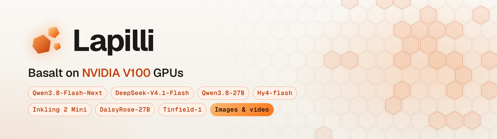
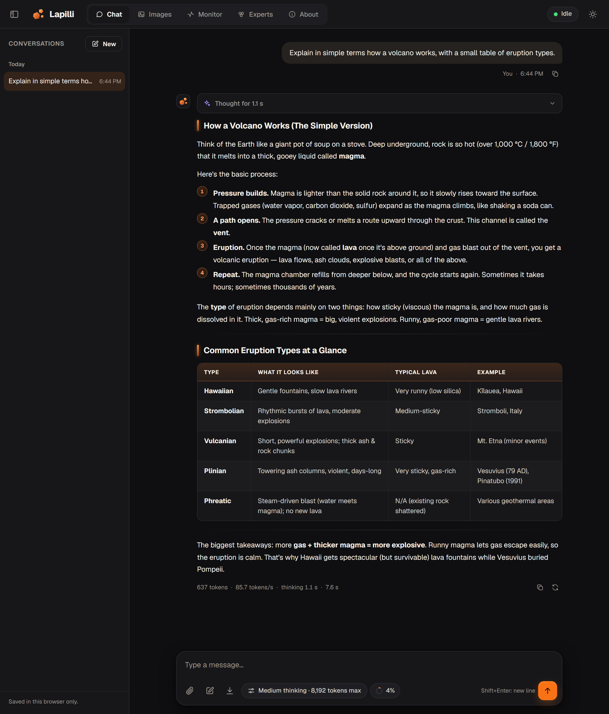
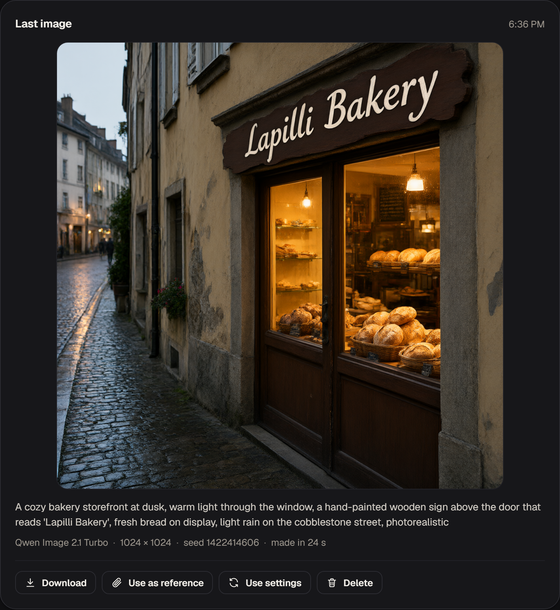
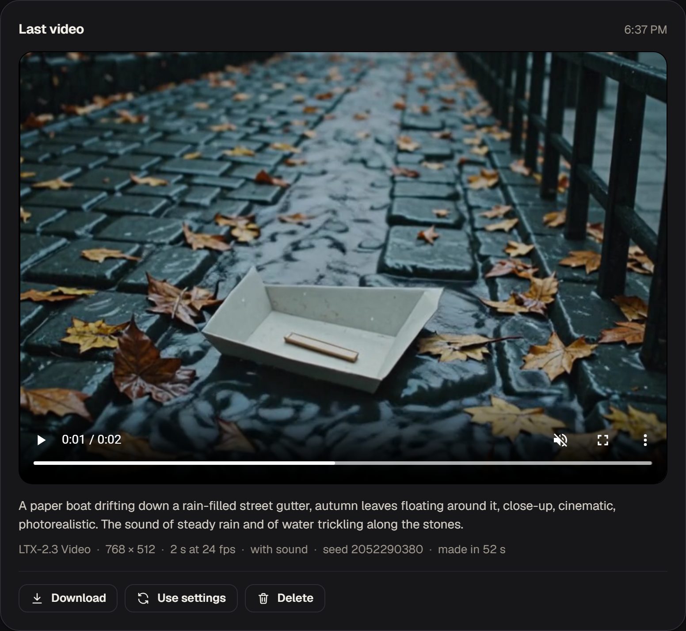
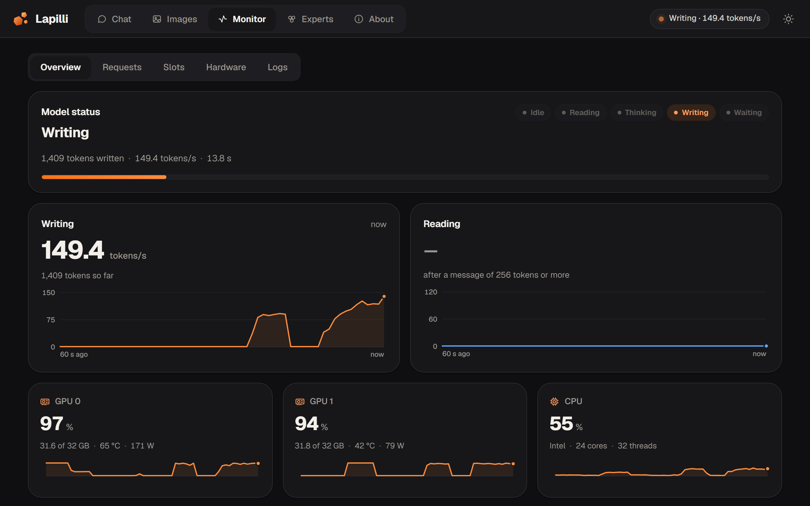
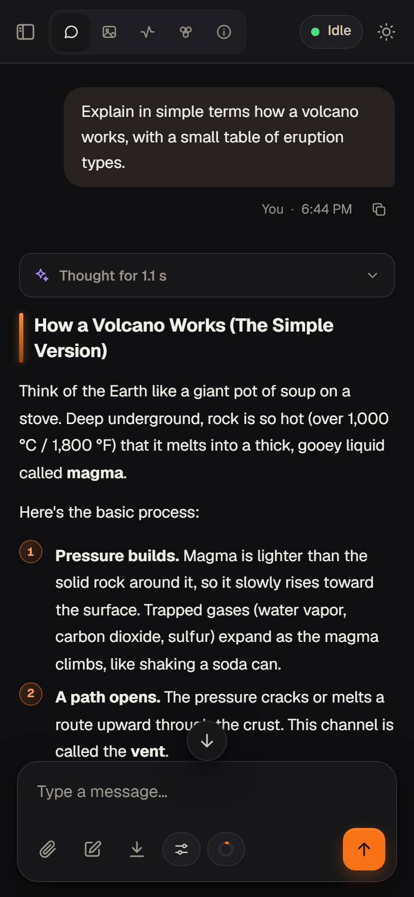
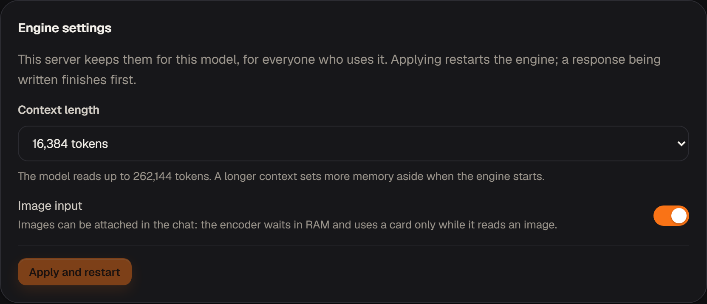
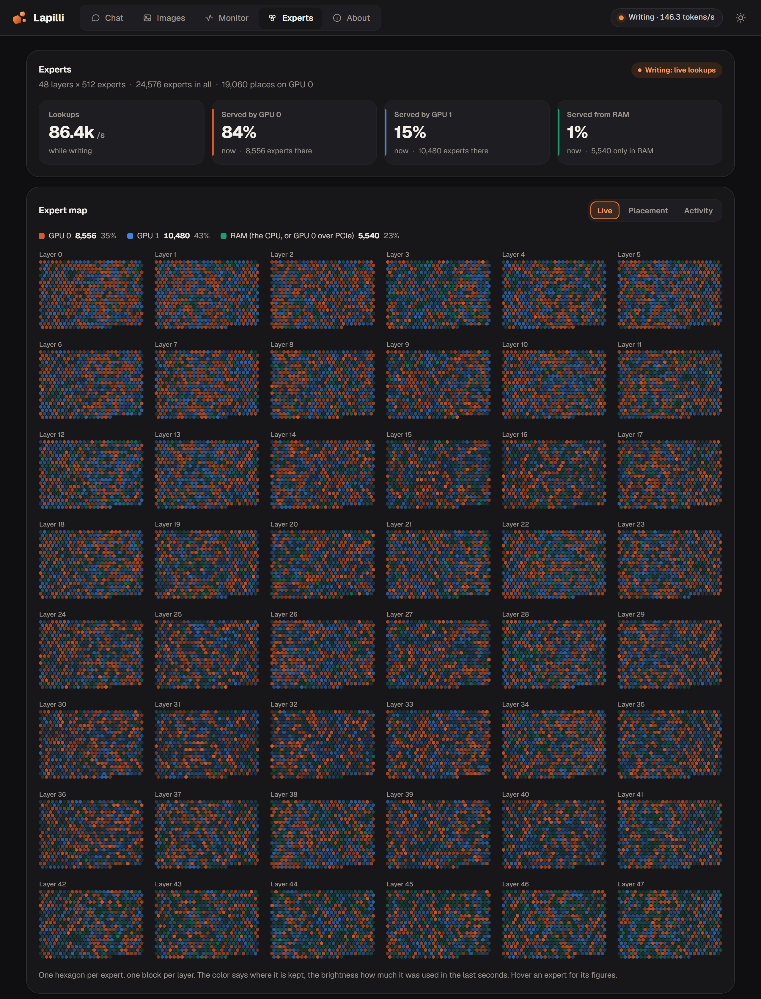

<p align="center">
  <picture>
    <source media="(prefers-color-scheme: dark)" srcset="docs/img/lapilli-banner-dark.png">
    
  </picture>
</p>

<p align="center">
  <a href="https://github.com/chris83-dev/lapilli-v100/releases"></a>
  
  
  
  <a href="LICENSE"></a>
</p>

<p align="center">
  <b>Your V100 isn't done yet.</b><br>
  A port of <a href="https://github.com/jesdga95/basalt">Basalt</a> to Volta (compute capability 7.0), with a chat page,
  images and video, and a live monitor.
</p>

<p align="center">
  <a href="#the-models">Models</a> ·
  <a href="#images-and-video">Images and video</a> ·
  <a href="#recommended-models">Downloads</a> ·
  <a href="#whats-new-in-v06">What's new</a> ·
  <a href="#tested-by-the-community">Community</a> ·
  <a href="#quick-start-windows">Quick start</a> ·
  <a href="#build">Build</a> ·
  <a href="README.fr.md">Français</a>
</p>

Upstream Basalt targets Blackwell (sm_120) only. Lapilli adds sm_70 and keeps the Blackwell build as it was. One
`basalt.exe` runs all five of Basalt's model families on V100 cards, and fine-tunes of them made with Basalt's own converter;
the server keeps Basalt's OpenAI and Anthropic APIs and serves the Lapilli page at `/` (Basalt's dashboard moves to
`/dashboard`). The page's **Images** tab draws, edits and films, with sound, through
[stable-diffusion.cpp](https://github.com/leejet/stable-diffusion.cpp)'s `sd-server`, on the same cards.

*Lapilli are the small fragments a volcano throws out: small pieces of basalt.*

<p align="center"></p>
<p align="center">&nbsp;&nbsp;</p>
<p align="center">&nbsp;&nbsp;</p>
<p align="center"></p>
<p align="center"></p>
<p align="center"><sub>The chat page and the same page on a phone, with Qwen3.8-Flash-Next on two V100s; a picture made by Qwen Image
2.1 Turbo and a video with its sound made by LTX-2.3, in the Images tab; the Monitor and the Experts tab, all 24,576 experts of
the Flash-Next, while it writes code; the Engine settings card. Screenshots of this build.</sub></p>

> Based on Basalt 0.5.6 and the 29 upstream commits after it (`main` at `bec30528`, November 23, 2026).
> Provided as is, without support (see [Support](#support)).

## The models

| | GPUs | Pack | Writing speed | Prompt reading | Quality against BF16 |
|---|---|---|---|---|---|
| **Qwen3.8-27B**<br><sub>dense, NVFP4</sub> | **1 × V100** | 21 GB, the official pack | **86** tokens/s with its drafter on a conversation, 187 on structured output | 994 tokens/s at 16K, 894 at 32K | KLD 0.02297, same top-1 93.37% |
| **Inkling 2 Mini**<br><sub>26B mixture of experts</sub> | **1 × V100** | 19.7 GB, the official `DQ8` pack | **121** tokens/s with its drafter on a conversation, 214 on structured output | 1,567 tokens/s at 16K, 1,459 at 32K | KLD 0.00295, same top-1 97.77% |
| **DaisyRose-27B**<br><sub>a fine-tune of the 27B</sub> | **1 × V100** | 23.7 GB, converted (see below) | **85** tokens/s with its drafter on a conversation, 174 on structured output | 835 tokens/s at 16K, 757 at 32K | KLD 0.02467, same top-1 92.17% |
| **DeepSeek-V4.1-Flash Coder**<br><sub>192 experts, IQ2_XXS</sub> | 2 × V100 | 192 GB, converted (see below) | **98** tokens/s on code, 63 on prose, with its DSpark drafter | | no BF16 reference for this pack ([see below](#measured-details)) |
| **Qwen3.8-Flash-Next**<br><sub>mixture of experts</sub> | 2 × V100 | 115 GB, `UD-Q4_K_XL` | **137** tokens/s on a long answer with reasoning, 92 on a short one | 1,173 tokens/s at 4K, 1,448 at 16K | KLD 0.04900, same top-1 92.67% |
| **Tinfield-1**<br><sub>a fine-tune of the Flash-Next</sub> | 2 × V100 | 115 GB, converted (see below) | **135** tokens/s on a long answer with reasoning, 91 on a short one | 1,177 tokens/s at 4K, 1,447 at 16K | against the Flash-Next's BF16: KLD 0.04850, same top-1 92.62% |
| **Hy4-flash**<br><sub>220B, 12B active</sub> | 2 × V100 | 159 GB, the official pack | **72** tokens/s on a long answer with reasoning, 82 on code | 748 tokens/s at 16K | KLD 0.20614, same top-1 86.26% |

Measured on one machine: 2 × V100-SXM2 32 GB (on PCIe 3.0 x16 and x4 links, peer-to-peer off: see below), Intel Core
i9-14900K, 96 GB of RAM, Windows 10, CUDA 12.6, NVIDIA driver 561.17, the packs on an NVMe SSD. Measured on November 27, 2026,
with the build from this repository. Speeds measured through the server are the median of three runs; `basalt-bench`'s are
its mean of three runs. Quality is Basalt's own gate (`basalt-bench --quality 100`: 100 chunks through the decode path,
against the BF16 reference). Tinfield-1 has no BF16 reference of its own: against the Flash-Next's, its figure measures how
far it is from the Flash-Next in BF16, its fine-tuning included.

## Images and video

The page's **Images** tab draws a picture from a prompt, edits your own pictures, and makes videos of up to five seconds,
with their sound for LTX-2.3. It runs stable-diffusion.cpp's `sd-server` on one card, as a second engine: the cards hold one
engine at a time, so a picture unloads the chat model and starts `sd-server`, and the next chat message stops it and loads
the chat model again. While it draws, the page shows a rough preview and the time left. A video comes back as an MP4 made by
`ffmpeg`, ready to play in the page.

| In the page | What it does | On one V100 | License of the model |
|---|---|---|---|
| **Qwen Image 2.1 Turbo** | pictures in 8 steps, and edits from reference pictures | 11.4 s for 1024 × 1024 | [Qwen Research License](https://huggingface.co/Qwen/Qwen-Image-2.1/blob/main/LICENSE) |
| **Qwen Image 2.1** | slower and finer, with guidance and a negative prompt | 101 s for 1024 × 1024 | [Qwen Research License](https://huggingface.co/Qwen/Qwen-Image-2.1/blob/main/LICENSE) |
| **Qwen Image Edit 2511 Lightning** | edits your pictures in 8 steps | 55 s for 1024 × 1024 | Apache 2.0 |
| **Qwen Image Edit 2511** | edits your pictures and keeps faces, objects and text as they are | 229 s for 1024 × 1024 | Apache 2.0 |
| **Wan 2.2 Video** | a video from a prompt, or from a start picture | 276 s for 5 s at 832 × 480 | Apache 2.0 |
| **LTX-2.3 Video** | a video **with its sound**, from a prompt or a start picture | 59 s for 5 s at 768 × 512 | [LTX-2 Community License](https://github.com/Lightricks/LTX-2/blob/main/LICENSE-2) |

Times from the click to the finished file in the page, the model already loaded (the second job in a row). The first job
after a chat message, or after a change of model, starts `sd-server` and reads the model's files first: 12 s more
for the Turbo, its files on an NVMe SSD.

**The tab installs its models itself.** The Windows archive includes `sd-server`, built for sm_70, and no image model:
choose a model in the tab, accept its licenses, click **Install**. The server downloads its files from Hugging Face, at the
revisions measured here, checks each one by its SHA-256 and puts it in place; a cut download goes on where it stopped. Each
model has its own license, and so do the text encoders some of them use: read them before you use what they make. Sizes,
licenses, the setup by hand (Linux, your own files) and the server's options: [docs/images.md](docs/images.md).

## Recommended models

The packs every figure above was measured with, and where to download them. Each pack has its own license on its Hugging
Face page.

The context length and the image input are set in the page (About, **Engine settings**) and kept for each model file:
without a choice, 65,536 tokens and images on when the pack carries a vision encoder. The commands below leave them to the
page; `--max-context N` or `--vision` on the command line override it.

### Qwen3.8-27B, on one V100

A dense model of 27 billion parameters: 64 layers (48 Gated DeltaNet, 16 gated attention), thinking and tools, a context of
up to 262,144 tokens, and a DFlash 2 block drafter in the pack that writes several tokens at a time.

- **Pack**: `Qwen3.8-27B-QUASAR-NVFP4.basalt`, 21.1 GB: the official Basalt pack (NVFP4 weights, from QUASAR's checkpoint)
- **Download**: [jesdga/Qwen3.8-27B-Basalt](https://huggingface.co/jesdga/Qwen3.8-27B-Basalt) · [direct link](https://huggingface.co/jesdga/Qwen3.8-27B-Basalt/resolve/main/Qwen3.8-27B-QUASAR-NVFP4.basalt)
- **Needs**: one V100 32 GB

```bat
hf download jesdga/Qwen3.8-27B-Basalt Qwen3.8-27B-QUASAR-NVFP4.basalt --local-dir models
bin\basalt.exe serve models\Qwen3.8-27B-QUASAR-NVFP4.basalt --gpu 0 --kv int8 --port 8080
```

### Inkling 2 Mini, on one V100

Thinking Machines Lab's mixture of experts: 26.2 billion parameters, 3.4 billion active (128 experts, 8 chosen for each
token), its 12 middle layers run three times for each token, image input, a context of up to 1,048,576 tokens, and a DSpark
drafter in the pack. Basalt's drafter for it is written for Blackwell; Lapilli gives it a V100 path, on by default, with the
same text as without it.

- **Pack**: `Inkling-2-Mini-NVFP4-DQ8.basalt`, 19.7 GB, the official pack at revision `3d27b47c`: the routed experts of its last four
  layers, MXFP8 in the release, hold the same values in Q8_0, which a V100 runs on its dp4a path. The newer `MX8` pack keeps
  them in MXFP8; it is not tested on V100.
- **Download**: [jesdga/Inkling-2-Mini-Basalt](https://huggingface.co/jesdga/Inkling-2-Mini-Basalt/tree/3d27b47c40f290ecfbf3ae70265bddb65c2635c1) · [direct link](https://huggingface.co/jesdga/Inkling-2-Mini-Basalt/resolve/3d27b47c40f290ecfbf3ae70265bddb65c2635c1/Inkling-2-Mini-NVFP4-DQ8.basalt)
- **Needs**: one V100 32 GB

```bat
hf download jesdga/Inkling-2-Mini-Basalt Inkling-2-Mini-NVFP4-DQ8.basalt --revision 3d27b47c40f290ecfbf3ae70265bddb65c2635c1 --local-dir models
bin\basalt.exe serve models\Inkling-2-Mini-NVFP4-DQ8.basalt --gpu 0 --kv fp16 --vram-reserve-mib 700 --port 8080
```

### DaisyRose-27B, a fine-tune of the 27B, on one V100

RadixArk's [DaisyRose-27B](https://huggingface.co/RadixArk/DaisyRose-27B) is the Qwen3.8-27B trained further by reinforcement
learning (Apache 2.0), better than its base on agent tasks according to its authors. It has the 27B's architecture and
tokenizer, so Basalt's converter builds its pack from RadixArk's NVFP4 checkpoint, with the 27B's DFlash 2 drafter, in about
two minutes. A V100 has no FP8: its FP8 attention and Gated DeltaNet weights become Q8_0 at load, so it takes 2.8 GiB more on
the card than the 27B and reads 17% more bytes for each token.

- **Checkpoint**: [RadixArk/DaisyRose-27B-NVFP4](https://huggingface.co/RadixArk/DaisyRose-27B-NVFP4) (revision `d7a48599`, 6 files)
- **Drafter**: [z-lab/Qwen3.8-27B-DFlash2](https://huggingface.co/z-lab/Qwen3.8-27B-DFlash2) (revision `50307d4c`)
- **Needs**: one V100 32 GB

```bat
hf download RadixArk/DaisyRose-27B-NVFP4 --revision d7a485994f1cc0c756efb9f157a9842b2df703fc --local-dir checkpoints\daisyrose-nvfp4
hf download z-lab/Qwen3.8-27B-DFlash2 --revision 50307d4c4cde6860d4eee73e2547cd786fe8e8a4 --local-dir checkpoints\dflash2
.venv\Scripts\python tools\convert\convert.py --checkpoint checkpoints\daisyrose-nvfp4 --drafter checkpoints\dflash2 --name "DaisyRose-27B NVFP4" --out models\DaisyRose-27B-NVFP4.basalt
bin\basalt.exe serve models\DaisyRose-27B-NVFP4.basalt --gpu 0 --kv int8 --port 8080
```

The finished pack is 23,749,973,433 bytes. There is no BF16 reference for it upstream: the one its quality figure was
measured against was made the same way as Basalt's, from the BF16 GGUF ([bartowski](https://huggingface.co/bartowski/RadixArk_DaisyRose-27B-GGUF))
through llama.cpp's `llama-perplexity`.

### DeepSeek-V4.1-Flash Coder, on two V100s

DeepSeek-V4.1-Flash is a mixture of experts: 40 layers of 384 experts, 6 chosen for each token plus a shared one.
ISTA-DASLab's GSQ-RCO Coder is a version for code that keeps 192 of the 384 experts of each layer, in IQ2_XXS; Unsloth's DSpark
drafter writes several tokens at a time. There is no ready-made Basalt pack for it: you build it from the GGUF files (about
184 GB to download, 192 GB once built).

- **Model**: [ISTA-DASLab/DeepSeek-V4.1-Flash-1017-GSQ-RCO-Coder-GGUF](https://huggingface.co/ISTA-DASLab/DeepSeek-V4.1-Flash-1017-GSQ-RCO-Coder-GGUF) (revision `54229d38`): the five parts of `IQ2_XXS/` (72.1 GB), the Engram table `DeepSeek-V4.1-Flash-Engram-IQ4_NL.gguf` (110.6 GB) and `mmproj-DeepSeek-V4.1-Flash-1017-BF16.gguf` (1.0 GB)
- **Drafter**: [unsloth/DeepSeek-V4.1-Flash-1017-GGUF](https://huggingface.co/unsloth/DeepSeek-V4.1-Flash-1017-GGUF) (revision `dfcee0ec`): `dspark-DeepSeek-V4.1-Flash-1017-Q8_0.gguf` (8.0 GB)
- **Needs**: two V100 32 GB, 96 GB of RAM with 20 GB kept free (its RAM tier is pinned), a fast NVMe SSD

1. Put the five `IQ2_XXS` parts, the `mmproj` file and the Engram table in one folder, the Engram table renamed as the sixth
   part: `DeepSeek-V4.1-Flash-1017-GSQ-RCO-Coder-IQ2_XXS-00006-of-00006.gguf`.
2. Convert, then add the drafter (the converter reads the GGUF files memory-mapped: about 10 minutes from an NVMe SSD), then
   start the server:

```bat
.venv\Scripts\python tools\convert\convert.py --gguf <folder>\DeepSeek-V4.1-Flash-1017-GSQ-RCO-Coder-IQ2_XXS-00001-of-00006.gguf --mmproj <folder>\mmproj-DeepSeek-V4.1-Flash-1017-BF16.gguf --out models\DeepSeek-V4.1-Flash-1017-GSQ-RCO-Coder-IQ2_XXS.basalt
.venv\Scripts\python tools\convert\convert.py --dspark dspark-DeepSeek-V4.1-Flash-1017-Q8_0.gguf --into models\DeepSeek-V4.1-Flash-1017-GSQ-RCO-Coder-IQ2_XXS.basalt --undo-dir models\dspark-undo
bin\basalt.exe serve models\DeepSeek-V4.1-Flash-1017-GSQ-RCO-Coder-IQ2_XXS.basalt --gpu 0,1 --kv fp16 --vram-reserve-mib 700 --ram-reserve-mib 20480 --port 8080
```

The finished pack is 192,059,655,012 bytes, in 14 sections. Its expert ranking for 192 experts, derived from the base model's
by `tools/profiles/derive_pruned_profile.py`, is in `data/profiles/`. A V100 has no FP8: the cache is fp16.

### Qwen3.8-Flash-Next, on two V100s

A mixture of experts: 48 layers (36 Gated DeltaNet, 12 QSA attention) of 512 experts, 10 chosen for each token, an MTP drafter
in the pack, and image input. The experts that do not fit in VRAM are read from RAM, and its per-layer token table is read
from the pack for every token: keep the pack on an NVMe SSD.

- **Pack**: `Qwen3.8-FN-UD-Q4_K_XL.basalt`, 115 GB (K-quants: the NVFP4 packs of this model need FP4 hardware)
- **Download**: [jesdga/Qwen3.8-Flash-Next-Basalt](https://huggingface.co/jesdga/Qwen3.8-Flash-Next-Basalt) · [direct link](https://huggingface.co/jesdga/Qwen3.8-Flash-Next-Basalt/resolve/main/Qwen3.8-FN-UD-Q4_K_XL.basalt)
- **Needs**: two V100 32 GB, 96 GB of RAM, a fast NVMe SSD
- **Smaller**: `Qwen3.8-FN-UD-IQ3_XXS.basalt` (87.6 GB, same page), run by a user on one V100 16 GB: see [the report](docs/community/v100-16gb-linux.md)

```bat
hf download jesdga/Qwen3.8-Flash-Next-Basalt Qwen3.8-FN-UD-Q4_K_XL.basalt --local-dir models
bin\basalt.exe serve models\Qwen3.8-FN-UD-Q4_K_XL.basalt --gpu 0,1 --kv int8 --mmap-experts --resident-experts --peer-exclusive --vram-reserve-mib 700 --ram-reserve-mib 16384 --port 8080
```

### Tinfield-1, a fine-tune of the Flash-Next, on two V100s

badtheorylabs' [Tinfield-1](https://huggingface.co/badtheorylabs/Tinfield-1) is the Flash-Next trained further for terminal
work and long software tasks (Qwen Community License 1.0). Only its attention, Gated DeltaNet and hyper-connection weights
changed: its experts, routers, head, embeddings, vision encoder and MTP layer are the Flash-Next's. So its pack is its own GGUF
with the Flash-Next pack's drafter and vision sections, and it runs at the Flash-Next's speed.

- **Model**: [badtheorylabs/Tinfield-1-Q4_K_XL-GGUF](https://huggingface.co/badtheorylabs/Tinfield-1-Q4_K_XL-GGUF) (revision `ea53c4c6`, six parts, 111 GB)
- **Base pack**: the Flash-Next pack above (its drafter and vision sections are copied into the new pack)
- **Needs**: two V100 32 GB, 96 GB of RAM, a fast NVMe SSD

```bat
hf download badtheorylabs/Tinfield-1-Q4_K_XL-GGUF --revision ea53c4c66cff9efdd08c96423838d9a221cca53e --local-dir checkpoints\tinfield
.venv\Scripts\python tools\convert\convert.py --gguf checkpoints\tinfield\tinfield-1-Q4_K_XL-00001-of-00006.gguf --sections-from models\Qwen3.8-FN-UD-Q4_K_XL.basalt --compat-bf16 --name "Tinfield-1 Q4_K_XL" --out models\Tinfield-1-Q4_K_XL.basalt
bin\basalt.exe serve models\Tinfield-1-Q4_K_XL.basalt --gpu 0,1 --kv int8 --mmap-experts --resident-experts --peer-exclusive --vram-reserve-mib 700 --ram-reserve-mib 16384 --port 8080
```

`--compat-bf16` turns the small matrices this GGUF stores in Q8_0 into the BF16 form the engine reads. The finished pack is
115,250,943,691 bytes; `convert.py --verify` reads it back against the GGUF: every tensor is the same, byte for byte, except
the 483 turned into BF16. `--dry-run` does not work with `--sections-from`: run the conversion itself.

### Hy4-flash, on two V100s

Tencent's mixture of experts: 220 billion parameters, 12 billion active, an Engram table read from the pack as it goes, image
input, and a context of up to 1,048,576 tokens (Tencent Hy License 1.0).

- **Pack**: `Hy4-flash-NVFP4.basalt`, 159 GB: the official Basalt pack
- **Download**: [jesdga/Hy4-flash-Basalt](https://huggingface.co/jesdga/Hy4-flash-Basalt) · [direct link](https://huggingface.co/jesdga/Hy4-flash-Basalt/resolve/main/Hy4-flash-NVFP4.basalt)
- **Needs**: two V100 32 GB, 96 GB of RAM, a fast NVMe SSD. Every expert must fit on a card or in RAM: on 96 GB, keep the
  reserve at 10 GB as below.

```bat
hf download jesdga/Hy4-flash-Basalt Hy4-flash-NVFP4.basalt --local-dir models
bin\basalt.exe serve models\Hy4-flash-NVFP4.basalt --gpu 0,1 --kv fp16 --vram-reserve-mib 700 --ram-reserve-mib 10240 --port 8080
```

Choose the context you need: without CUDA's virtual memory management (the test machine's V100s, under Windows, have none),
the engine reserves the whole cache at start. There, 262,144 tokens take 3.6 GiB of the first card; 1,048,576 take 14.3 GiB,
which leaves fewer experts on the card and slows writing by about a third.

## Measured details

<details>
<summary><b>Qwen3.8-27B on one V100</b></summary>

A V100 has neither FP4 nor FP8 tensor cores. At load, the pack's NVFP4 planes become ggml's NVFP4 blocks in place and the
FP8 head becomes Q8_0; the products run on the dp4a path and, for long prompts, on Volta's own tensor cores. New in v0.6:
from 1,024 rows a chunk, the prompt's products decode the NVFP4 weights to FP16 in slices (exactly) and run as FP16 products
on the tensor cores, with one fixed algorithm, so that a row's result does not depend on the chunk's size
(`BASALT_DENSE_HGEMM=0` turns it off). The activations stay in 8 bits on the dp4a path, where Blackwell rounds them to 4.

| | Lapilli, 1 × V100 | Basalt's figures on an RTX 5090 (int8 cache) |
|---|---|---|
| Perplexity (BF16: 6.7411) | 6.8304 | 6.826 |
| Mean KLD | 0.02297 | 0.0259 |
| Same top-1 token | 93.37% | 92.89% |

| Writing (`basalt-bench -t conv,struct,prose`, seed 7) | conversation | structured | prose |
|---|---|---|---|
| With the DFlash 2 drafter (the default) | 86 | 187 | 65 |
| Without a drafter (`--spec 0`) | 40 | 37 | 38 |

| Prompt reading, tokens/s | 16K | 32K | 64K |
|---|---|---|---|
| v0.6 | 994 | 894 | 740 |
| v0.5, same machine | 693 | 633 | 554 |

Writing after a long prompt, without a drafter: 33.3 tokens/s after 32K, 29.9 after 64K
(`basalt-bench --depth-decode`). Tokens/s, in tokens of the answer.

</details>

<details>
<summary><b>Inkling 2 Mini on one V100</b></summary>

| | Lapilli, 1 × V100 | Basalt's figures on an RTX 5090 |
|---|---|---|
| Perplexity (BF16: 7.0633) | 7.0731 | 7.0695 |
| Mean KLD | 0.00295 | 0.00305 |
| Same top-1 token | 97.77% | 97.76% |

| Writing (`basalt-bench -t conv,struct,prose`, seed 7) | conversation | structured | prose |
|---|---|---|---|
| With the DSpark drafter (the default) | 121 | 214 | 103 |
| Without a drafter (`--spec 0`) | 95 | 92 | 95 |

Prompt reading: 1,567 tokens/s at 16K tokens, 1,459 at 32K, its prompt attention on Volta's tensor cores (WMMA).
On V100 the experts' L2 read-ahead, made for Blackwell's large L2, is off.

</details>

<details>
<summary><b>DaisyRose-27B on one V100</b></summary>

| | DaisyRose-27B | Qwen3.8-27B, same runs |
|---|---|---|
| Perplexity (its own BF16: 6.7646) | 6.8360 | 6.8304 |
| Mean KLD | 0.02467 | 0.02297 |
| Same top-1 token | 92.17% | 93.37% |
| Writing with the drafter, conversation / structured / prose | 85 / 174 / 59 | 86 / 187 / 65 |
| Prompt reading at 16K / 32K | 835 / 757 | 994 / 894 |

</details>

<details>
<summary><b>DeepSeek-V4.1-Flash Coder on two V100s</b></summary>

Writing, greedy, through the server (the median of three runs after a warm-up): 98 tokens/s on code (a complete
Python class, 512 tokens), 63 on prose (256 tokens), with the DSpark drafter.

There is no BF16 reference for this pack. Against the one of the full DeepSeek-V4.1-Flash (384 experts, Basalt's
`dsv41-bf16-base.kld`, base PPL 2.7314), it scores PPL 5.4196, KLD 0.85367 and the same top-1 token 70.27% over
the 100 chunks of wikitext-2; v0.5, the same night: 0.85386 and 70.30%. These figures measure what half of the
experts removed and IQ2_XXS cost together on prose, not the pack's own error: the pack is made for code.

This model keeps a faster V100 layout for its Q5_K products, on by default for it alone: with it a row's bits depend on
the width of its window, but its text already depends on where its experts live (on a card or in RAM), run to run.
`BASALT_MULTI_V70=0` turns it off.

</details>

<details>
<summary><b>Qwen3.8-Flash-Next and Tinfield-1 on two V100s</b></summary>

| | Flash-Next | Tinfield-1 | Basalt's published figures for the Flash-Next pack (RTX 5090) |
|---|---|---|---|
| Perplexity (the Flash-Next's BF16: 3.2733) | 3.3245 | 3.2172 | 3.321 |
| Mean KLD, against the Flash-Next's BF16 | 0.04900 | 0.04850 | 0.0496 |
| Same top-1 token | 92.67% | 92.62% | 92.63% |

| | Flash-Next, v0.6 | Flash-Next, v0.5 (same machine and runs) | Tinfield-1 |
|---|---|---|---|
| Writing, short answer (256 tokens, temperature 0) | 92 tokens/s | 91 tokens/s | 91 tokens/s |
| Writing, long answer with reasoning (1,500 tokens) | 137 tokens/s | 140 tokens/s | 135 tokens/s |
| Prompt reading, ~4,200 / ~16,000 tokens | 1,173 / 1,448 tokens/s | 1,169 / 1,446 tokens/s | 1,177 / 1,447 tokens/s |

</details>

<details>
<summary><b>Hy4-flash on two V100s</b></summary>

| | Lapilli, 2 × V100 | Basalt's figures (RTX 5090 and RTX 5060 Ti) |
|---|---|---|
| Mean KLD | 0.20614 | 0.201 |
| Same top-1 token | 86.26% | 86.09% |

NVFP4 costs this model more than the others, on Blackwell as here. Writing: 72 tokens/s on a long answer with reasoning (1,500
tokens), 82 on code (a complete Python class, 512 tokens); prompt reading 624 tokens/s at 4K, 748 at 16K. Its prompt attention (MLA) runs on Volta's tensor cores
(WMMA); the second card's expert rows are summed for each token in FP16 before they cross the bus.

</details>

141 of Basalt's 156 GPU parity tests pass on a V100. The others test paths a V100 does not take: Blackwell-only kernels
(FP8, FP4, TMA), thread-block clusters (the engine uses its cluster-free fallback), more than 96 KB of shared memory per
block, a bf16 test that sm_70 cannot build, and three DeepSeek fingerprints recorded on Blackwell, whose bits add in
another order on Volta (their numerical checks pass). For the 27B and the Flash-Next, every row of a product gives the
same bits whatever the width of its window, so a drafter changes the speed, never the answer.

## What's new in v0.6

- **Two new model families on Volta.** **Hy4-flash** on two V100s: its MLA prompt attention on the tensor cores, the second
  card's expert rows summed in FP16 before they cross the bus, the experts' L2 read-ahead off on a card with a small L2.
  **Inkling 2 Mini** on one V100: its DSpark drafter on V100, its prompt attention on the tensor cores, the same quality as
  upstream on an RTX 5090.
- **Fine-tunes, converted in minutes** with Basalt's own converter: DaisyRose-27B from its NVFP4 checkpoint, Tinfield-1 from
  its GGUF with the Flash-Next pack's drafter and vision.
- **The 27B reads long prompts faster**: +43% at 16K, from FP16 products on the tensor cores (an idea from
  [ninfer-v100-fast](https://github.com/ddominet/ninfer-v100-fast), Apache 2.0). At the end of its context, it now stops writing
  instead of failing.
- **Images and video**: the Images tab, with `sd-server` as a second engine on the same cards, and its models installed from
  the tab with one click (see [Images and video](#images-and-video)).
- **Engine settings in the page** (About): the context length and the image input, kept for each model file and applied by
  restarting the engine.
- **A long conversation goes on**: when it nears the end of the context, the page leaves earlier thinking out, or replaces
  the oldest turns by a summary; a response that the context cuts goes on in its bubble (**Continue**), as in llama.cpp's
  page. The server continues a conversation that ends with an assistant message (`--prefill-assistant`, on by default).
- **"This page was updated"**: the page says when the server's files are newer than the ones it runs.
- **Basalt 0.5.6**: the fork follows upstream `main` again (515 upstream commits since v0.5's base), with every
  Volta path kept.
- **From the community**: koldfrontier's two fixes, a vision test that builds with CUDA 12.8 and gcc 14.3, and the
  converter's dry run that no longer stops at the `hc8` section.
- **Lapilli's own version**: the About tab and `/metrics` give Lapilli's number (0.6.0) beside Basalt's (0.5.6).

The previous releases, [v0.5.0-v100.1](https://github.com/chris83-dev/lapilli-v100/releases/tag/v0.5.0-v100.1) and
[v0.4.0-v100.1](https://github.com/chris83-dev/lapilli-v100/releases/tag/v0.4.0-v100.1), stay available.

## Tested by the community

People tested Lapilli on their own machines and shared everything. Their figures, as they reported them:

| | Machine | What they ran | Their results |
|---|---|---|---|
| **[nebod99](docs/community/one-v100-pcie-linux.md)** | 1 × V100 PCIe 32 GB, Linux (CUDA 12.6.3 in Docker), i9-10940X, 96 GB | v0.4, Qwen3.8-Flash-Next `IQ3_S`, a 7,242-token prompt, thinking on | **100.9 tokens/s** at 128K context (Strata: 55.6), first token **8.7 s** (22.6); on 2,500+ questions, the same quality as Strata |
| **[ildargiv](docs/community/v100-16gb-linux.md)** | 1 × V100-SXM2 **16 GB**, Ubuntu 22.04, Ryzen 5 5600G, 96 GB | v0.4, Qwen3.8-Flash-Next `IQ3_XXS`, the first 16 GB card | **67.8 / 76.0 / 70.4 tokens/s** writing after 1K / 8K / 32K prompts; prompt reading 497 / 1,033 / 1,174 tokens/s; a stable 16 GB setup |
| **[Csavoldi](docs/community/inkling2-mini.md)** | 2 × V100 PCIe 32 GB, one in use | **Inkling 2 Mini** ported onto Lapilli: upstream Basalt v0.5.5 merged with the Volta paths | **69 tokens/s** writing (60.5 at 42K, 44.4 at 165K); prompt 850 tokens/s; 512K context; 5/5 top-1 against llama.cpp |
| **[koldfrontier](docs/community/two-v100-pcie-linux.md)** | 2 × V100 32 GB, both in use, Ubuntu 26.04, 2 × Xeon Gold 6138, 192 GB | v0.4 and v0.5, Qwen3.8-Flash-Next fine-tunes at Q5_K, two 262K slots | v0.4: two requests at once **69.8 tokens/s each** (Strata: 52.0), longest stall beside a 109K prompt **0.19 s** (7.0); one request 76 (Strata: 86); v0.5 the same speed as v0.4; peer access byte-exact on this board |
| **[nkhaooat](docs/community/three-engines-two-v100-pcie.md)** | 2 × V100 PCIe 32 GB (Gen3 x8, peer access on), Ryzen 9 7945HX3D, 96 GB, Linux | v0.5, Qwen3.8-Flash-Next `UD-Q4_K_XL`, 262K context, two slots, against Strata and sFNX on 966 graded trials | the same quality as the two others (860 passes; Strata 864, sFNX 858); **146.2 tokens/s** on edits and **117.6** on code (sFNX 107.7 / 101.3, Strata 59.5 / 77.1); prompt reading 1,453 tokens/s at 35.8K (sFNX 2,060) |

Thank you, nebod99, ildargiv, Csavoldi, koldfrontier and nkhaooat. Lapilli had only ever run on one machine; you took it to
Linux, to a single card, to a 16 GB V100, to a new model and to PCIe pairs with peer access on, measured it carefully against
other engines and wrote down what others need to do the same. Every V100 owner benefits from your work.

## Quick start (Windows)

1. Download `lapilli-v100-v0.6.0-v100.1-windows-x64.zip` from the [releases](https://github.com/chris83-dev/lapilli-v100/releases)
   and unzip it. It holds `bin\` (`basalt`, `basalt-bench`, `basalt-probe`, `basalt-vision`, and `sd-server`, `sd-cli` for
   the Images tab), the server, the page, `data\`,
   `docs\`, `requirements.txt` and the licences, built for the five model families; like Basalt's archives, no CUDA libraries
   and no Python environment.
2. Install an NVIDIA driver that supports CUDA 12.6 (tested: 561.17), the CUDA 12 runtime libraries on the `PATH`
   (`cudart64_12.dll`, `cublas64_12.dll`, `cublasLt64_12.dll`: the CUDA Toolkit 12.6 to 12.9 installs them) and the Microsoft
   Visual C++ 2015-2022 Redistributable (x64).
3. Create the Python environment at the archive's top directory: `py -3 -m venv .venv` then
   `.venv\Scripts\pip install -r requirements.txt`.
4. Download a pack and start the server with its command (see [Recommended models](#recommended-models)), then open
   `http://127.0.0.1:8080/`. The Images tab is there from the start: install a model from it.

## Requirements

- One or more NVIDIA V100 GPUs: one 32 GB card for the 27B, DaisyRose-27B and Inkling 2 Mini; two for the DeepSeek Coder, the
  Flash-Next, Tinfield-1 and Hy4-flash as measured. Tested by users: V100 PCIe 32 GB cards, alone and in pairs, and one
  V100-SXM2 16 GB with the Flash-Next (see [Tested by the community](#tested-by-the-community)).
- Windows 10 or 11 x64, or Linux (run by users with CUDA 12.6.3 in Docker, on Ubuntu 22.04, and on Ubuntu 26.04 with CUDA
  12.8; the build steps below are for Windows).
- CUDA Toolkit 12.6 to 12.9 (CUDA 13 dropped Volta), the Visual Studio 2022 Build Tools (C++), CMake 3.24+, Python 3.10+.
- System RAM and a fast SSD for the experts that do not fit in VRAM. Tested with 96 GB of RAM.
- For the Images tab: room on the disk for its models (13 to 40 GB each); the Windows archive includes `sd-server`, and the tab
  installs `ffmpeg` for the videos (on Linux: build `sd-server` and install `ffmpeg`, see [docs/images.md](docs/images.md)).

## Build

From an *x64 Native Tools Command Prompt for VS 2022*:

```bat
git clone https://github.com/chris83-dev/lapilli-v100 lapilli && cd lapilli
cmake -S . -B build70 -G Ninja -DCMAKE_BUILD_TYPE=Release -DCMAKE_CUDA_ARCHITECTURES=70 -DCMAKE_CUDA_RUNTIME_LIBRARY=Shared
cmake --build build70
py -3 -m venv .venv
.venv\Scripts\pip install -r requirements.txt
```

The executables land in `bin\`, built for the five model families (`-DBASALT_MODELS=` with a list such as `qwen4exp;qwen35`
builds fewer). A full build of the five model families, tests included, took 50 minutes on a 24-core i9-14900K with 6 parallel jobs. `-DCMAKE_CUDA_RUNTIME_LIBRARY=Shared` avoids a duplicate `cudart` at link time on Windows.
`-DBUILD_TESTING=ON` adds the parity tests (`ctest --test-dir build70 -L gpu`). On Linux, users built it with the same CMake
options (see their reports).

## What changed from Basalt

- **Build**: compute capability 7.0 is accepted next to 12.0, with CUDA 12.6 or newer.
- **A compatibility layer** (`include/basalt/kernels/volta_compat.cuh`): the newer PTX instructions the engine uses
  (`cp.async`, `ldmatrix`, the `mma` shapes of Turing and Ampere, tf32 and bf16 conversions) get a correct sm_70 equivalent,
  and `griddepcontrol` and the L2 prefetch become no-ops, so the kernels compile and run right on a V100. The kernels that
  need thread-block clusters get V100 versions without them.
- **V100 paths for the hot kernels**: llama.cpp's dp4a path for the quantized prompt products, and their NVFP4 version on
  Volta's tensor cores with the same bits; FP16 tensor-core products for the 27B's long prompts; int8 prompt attention on the
  V100 tensor cores (`mma.m8n8k4`, from Strata); the prompt attention of the 27B, Inkling 2 Mini and Hy4-flash on WMMA;
  hyper-connection reads, the router, the decode experts and the GDN recurrence rewritten for Volta; Inkling's DSpark drafter
  on V100; the DeepSeek indexer without clusters; the expert exchange between two cards tuned for V100.
- **Peer-to-peer access is off by default on Volta**: on the test machine, direct copies between the two V100s returned wrong
  data. The copies go through the host instead. `BASALT_PEER_NO_P2P=0` turns peer access back on, at your own risk. Two users
  run it on with PCIe pairs after a byte-exact test passed on their boards (see koldfrontier's and nkhaooat's reports): run
  such a test before you turn it on.
- **Server**: the exact resume of a follow-up turn; the expert map and the slots' figures on `/metrics` and `/slots`; a
  request's `fit_max_tokens: true` cuts its `max_tokens` to the room the context leaves; a conversation that ends with an
  assistant message continues it; the page's engine settings (`/api/engine-settings`); images and videos through `sd-server`
  (`/api/images`, and `POST /v1/images/generations`).
- **The Lapilli page** at `/`, with its Images tab; Basalt's dashboard at `/dashboard`.

The `BASALT_*` environment variables added by the port are the A/B switches used while measuring it; their defaults are the
best measured on V100, and they are not meant as settings. A few may help: `BASALT_MMQ_HMMA=0` and `BASALT_ATTN_PROMPT=i8`
put the prompt products and the prompt attention back on their v0.4 paths if a new path misbehaves on your card;
`BASALT_DENSE_HGEMM=0` puts the 27B's long prompts back on the v0.5 path; `BASALT_MULTI_V70=0` turns off the DeepSeek's faster
Q5_K layout (and `auto` turns it on for the other models).

## Not tested

NVLink with peer access on; the models other than the Flash-Next, and the Images tab, on Linux; packs other than those above
(and `IQ3_S`, `IQ3_XXS` and fine-tunes of the Flash-Next, run by users); the `MX8` pack of Inkling 2 Mini; Blackwell builds of
this fork.

## Support

This fork is shared as is, in the hope that it helps other V100 owners. There is no promise of support or updates. Issues
may be read, but may not get an answer.

## Credits and license

MIT, like Basalt ([LICENSE](LICENSE)). Lapilli stands on the work of others:

- [Basalt](https://github.com/jesdga95/basalt) by Jesús Gulfo (MIT): the engine, its five model families and the expert
  map's console.
- [Strata](https://github.com/Niko1221/Strata) by Niko1221 and the Strata contributors (MIT): Basalt's origin, and the V100
  prompt-attention kernel used here.
- [llama.cpp / ggml](https://github.com/ggml-org/llama.cpp) (MIT): the dp4a prompt products; its page's compaction and
  **Continue**, which the Lapilli page follows.
- [ninfer-v100-fast](https://github.com/ddominet/ninfer-v100-fast) by ddominet (Apache 2.0, after geoffwatts' ninfer-v100 and
  Neroued's ninfer): the idea of the 27B's FP16 prompt products.
- [stable-diffusion.cpp](https://github.com/leejet/stable-diffusion.cpp) by leejet (MIT): the `sd-server` of the Images tab.
- The models' authors (Qwen, DeepSeek, Tencent, Thinking Machines Lab, RadixArk, badtheorylabs, Wan-AI, Lightricks), and the
  packs and files: [ISTA-DASLab](https://huggingface.co/ISTA-DASLab) (the 192-expert Coder),
  [Unsloth](https://huggingface.co/unsloth) (the DSpark drafter, LTX-2.3 and other files in GGUF),
  [z-lab](https://huggingface.co/z-lab) (DFlash 2), lightx2v (the Lightning LoRA), leejet, QuantStack, city96 and
  mradermacher (GGUF files), jesdga (the Basalt packs).
- [marked](https://github.com/markedjs/marked) (MIT): the chat page's text formatting. Geist font (SIL Open Font License).

Every notice is in [THIRD_PARTY_LICENSES](THIRD_PARTY_LICENSES). Basalt's own README, with its models and documentation, is at
[github.com/jesdga95/basalt](https://github.com/jesdga95/basalt); this repository's `docs/` is Basalt's documentation, written
for Blackwell, with Lapilli's own pages added (the Images tab, the community's reports).

French: [README.fr.md](README.fr.md).
